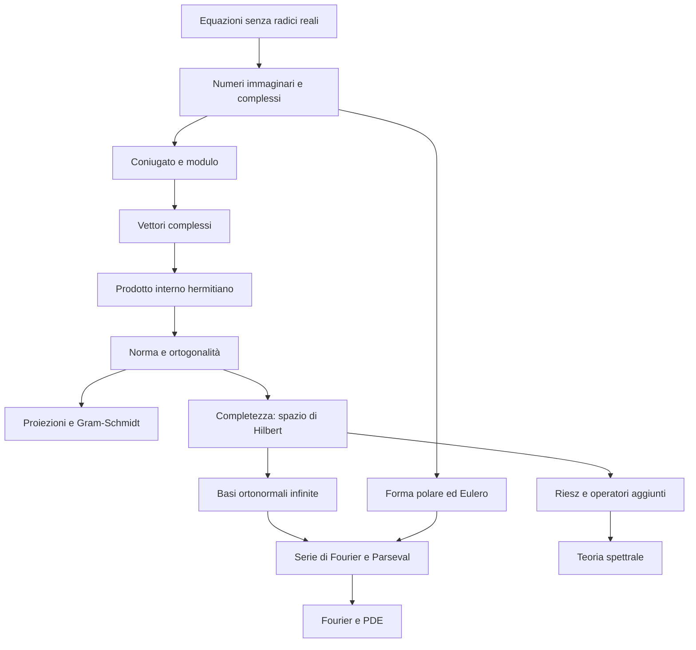

# Atlante dei ponti matematici

## Una tassonomia navigabile delle trasformazioni che rendono risolvibili i problemi

**Versione:** 1.0 — documento fondativo per una futura mappa HTML interattiva  
**Lingua:** italiano  
**Ambito:** dall'algebra elementare all'analisi funzionale, agli spazi di Hilbert e ai metodi per problemi avanzati  
**Formato logico:** albero delle conoscenze + grafo orientato dei ponti + percorsi guidati  
**Destinatari:** studenti autodidatti, universitari, docenti e sviluppatori di strumenti didattici.

> **Idea guida.** La matematica avanzata non è una collezione infinita di formule scollegate. È una rete di oggetti, proprietà e trasformazioni. Un problema difficile diventa spesso risolvibile non perché troviamo un calcolo più ingegnoso, ma perché scopriamo *in quale rappresentazione, sotto quali ipotesi e con quale informazione conservata* il problema si semplifica.

---

# 0. Incipit — che cosa significa «ponte matematico»

Un'equazione può essere difficile nei numeri reali e semplice nei complessi; una funzione può essere difficile da derivare in una rappresentazione, ma facile da manipolare attraverso una trasformata; una famiglia infinita di vettori può sembrare intrattabile finché non ne riconosciamo ortogonalità, norma e base. In ogni caso, il passaggio decisivo è un **ponte**: una trasformazione del problema oppure un teorema che permette di compiere un'operazione che altrimenti non sarebbe giustificata.

Questa mappa non vuole soltanto rispondere a «quali teoremi devo conoscere?». Deve rispondere soprattutto a cinque domande:

1. **Dove mi trovo?** In quale universo e struttura lavoro: numeri reali, complessi, vettori, funzioni, operatori, probabilità?
2. **Qual è il blocco?** Un'espressione non si fattorizza, le variabili sono accoppiate, compare un infinito, manca una soluzione esplicita?
3. **Quale ponte posso usare?** Una sostituzione, una decomposizione, un'estensione del dominio, una trasformata, una disuguaglianza, un teorema di esistenza?
4. **A quali condizioni?** Continuità, integrabilità, convergenza, invertibilità, completezza, regolarità, positività, condizioni al contorno?
5. **Che cosa ottengo?** Una soluzione esatta, una soluzione equivalente, una stima, un'approssimazione controllata, un risultato di esistenza oppure soltanto una condizione necessaria?

Un buon atlante deve distinguere rigorosamente questi casi. **Una trasformazione algebrica reversibile, una stima e un teorema di esistenza non sono lo stesso tipo di ponte.** Il loro ruolo nella risoluzione può essere simile, ma il contenuto logico è differente.

## 0.1 Obiettivi del documento

- Fornire un **albero gerarchico delle discipline e degli oggetti matematici**, dal livello introduttivo a quello avanzato.
- Definire una **tassonomia funzionale dei ponti**, organizzata per l'azione che compiono su un problema.
- Associare a ogni ponte **dominio di partenza, dominio di arrivo, prerequisiti, ipotesi, reversibilità, output e rischi**.
- Costruire **traiettorie didattiche** che colleghino, per esempio, numeri immaginari → complessi → prodotto scalare hermitiano → ortogonalità → Hilbert → Fourier → operatori.
- Includere esempi svolti, alcuni elementari e altri avanzati, per evitare una mappa fatta di soli nomi.
- Predisporre **identificatori persistenti** e regole di navigazione per una successiva interfaccia HTML, senza confondere la struttura delle discipline con quella dei metodi risolutivi.

## 0.2 Confini e interpretazione di «completo»

La matematica non ha un catalogo finito ed esaustivo di tutti i possibili teoremi. «Completo», qui, significa **completo come architettura estensibile**: comprende le principali famiglie, i ponti canonici, gli snodi fra discipline e uno schema uniforme con cui aggiungere nuove voci. Non pretende di elencare ogni risultato della ricerca matematica.

---

# 1. Grammatica della mappa: classi, nodi e relazioni

## 1.1 Le sei classi fondamentali di nodo

| Classe | Codice | Cosa rappresenta | Esempio |
|---|---|---|---|
| **Dominio** | `D-` | Insieme di oggetti e operazioni consentite | `D-01.1.5`: numeri complessi |
| **Concetto** | `C-` | Definizione, struttura o proprietà | `C-HERMITIAN`: prodotto hermitiano |
| **Problema** | `Q-` | Domanda o forma di problema | `Q-ODE1`: ODE del primo ordine |
| **Ponte** | `B-` | Metodo di trasformazione o passaggio logico | `B-04.05`: trasformata di Fourier |
| **Teorema / garanzia** | `T-` | Risultato che certifica il passaggio | `T-DCT`: convergenza dominata |
| **Esempio / percorso** | `E-` / `R-` | Applicazione verificabile o itinerario di studio | `E-H02`: proiezione hermitiana |

**Importante:** un teorema può essere la garanzia di un ponte, non necessariamente il ponte stesso. «Applicare Fourier» è un'operazione; «Plancherel» ne descrive una fondamentale proprietà in $L^2$.

## 1.2 I tipi di arco del grafo

| Arco | Significato | Direzione | Esempio |
|---|---|---|---|
| `IS_A` | Sottoclasse / specializzazione | padre → figlio | spazio di Hilbert → $L^2$ |
| `REQUIRES` | Prerequisito di comprensione | prerequisito → nodo | coniugio → prodotto hermitiano |
| `USES` | Un metodo usa un altro concetto | metodo → concetto | proiezione → ortogonalità |
| `TRANSFORMS_TO` | Cambia forma o rappresentazione | input → output | derivata → moltiplicazione in Fourier |
| `EQUIVALENT_TO` | Equivalenza con ipotesi dichiarate | doppia direzione | $z=0\Leftrightarrow |z|=0$ |
| `IMPLIES` | Conseguenza non necessariamente reversibile | una direzione | derivabilità → continuità |
| `GUARDED_BY` | Teorema o ipotesi legittimante | ponte → garanzia | scambio limite/integrale → DCT |
| `APPROXIMATES` | Sostituzione con errore controllato | originale → modello | funzione → polinomio di Taylor |
| `BOUNDS` | Produce una stima | oggetto → limite | prodotto scalare → Cauchy–Schwarz |
| `SOLVES` | Risolve una classe di problemi | ponte → problema | fattore integrante → ODE lineare |
| `GENERALIZES` | Estende risultati a un contesto maggiore | semplice → generale | dot product reale → hermitiano |
| `DUAL_TO` | Collega descrizioni duali | due direzioni | spazio → duale continuo |
| `COUNTEREXAMPLE_TO` | Mostra perché un'ipotesi è necessaria | esempio → errore | funzione liscia non analitica → Taylor non esatto |

**Non confondere** `IS_A` con `REQUIRES`: uno spazio di Hilbert è uno spazio normato completo con norma indotta da prodotto interno; non è una sottoclasse dei numeri complessi. Può essere **definito sopra** $\mathbb C$, il che è una relazione differente (`DEFINED_OVER`).

## 1.3 Semantica del risultato di un ponte

Definiamo esplicitamente il tipo di risultato:

- **`EXACT_EQUIVALENCE`**: conserva esattamente le soluzioni, eventualmente con restrizioni esplicite.
- **`EXACT_IMPLICATION`**: ogni soluzione originale produce la conseguenza; il ritorno potrebbe essere falso.
- **`EXACT_REPRESENTATION`**: stessa informazione, altra codifica, con condizioni di ricostruzione.
- **`SUFFICIENT_CONDITION`**: garantisce qualcosa senza essere necessariamente necessaria.
- **`NECESSARY_CONDITION`**: filtra candidati, non prova la soluzione.
- **`APPROX_WITH_ERROR`**: approssima con stima dell'errore o convergenza indicata.
- **`EXISTENCE`**, **`UNIQUENESS`**, **`REGULARITY`**, **`BOUND_ONLY`**, **`ALGORITHM`**.

## 1.4 Etichette di difficoltà

| Livello | Sigla | Competenze di ingresso indicative |
|---|---|---|
| 0 | `L0` | aritmetica, potenze, uguaglianze |
| 1 | `L1` | algebra elementare, equazioni, grafici |
| 2 | `L2` | trigonometria, complessi, vettori, limiti |
| 3 | `L3` | algebra lineare, derivate, integrali, ODE base |
| 4 | `L4` | analisi multivariabile, complessa, Fourier, probabilità |
| 5 | `L5` | misura, spazi normati, Hilbert, PDE, operatori |
| 6 | `L6` | analisi funzionale avanzata, teoria spettrale, distribuzioni, problemi deboli |

La difficoltà non è una proprietà assoluta: è il **costo didattico relativo ai prerequisiti**, non un giudizio sul valore del teorema.

---

# 2. PRIMO ALBERO — struttura delle conoscenze matematiche

Questo è l'albero di **«che cosa esiste e che cosa significa»**, distinto dall'albero dei ponti operativi. La notazione a livelli rende possibili menu a espansione e percorsi filtrati.

## D-00. Linguaggio e fondamenti (`L0–L4`)

- **D-00.1 Logica e dimostrazione**
  - D-00.1.1 Proposizioni; connettivi; quantificatori $\forall,\exists$.
  - D-00.1.2 Necessità, sufficienza, equivalenza, contrapposizione, assurdo.
  - D-00.1.3 Induzione; invarianti; controesempi.
  - D-00.1.4 Definizioni, assiomi, lemmi, teoremi e ipotesi.
- **D-00.2 Insiemi e relazioni**
  - D-00.2.1 Inclusione, unione, intersezione, prodotto cartesiano.
  - D-00.2.2 Funzioni, immagini, controimmagini, inversa, composizione.
  - D-00.2.3 Equivalenze, ordini, classi quoziente.
- **D-00.3 Strumenti trasversali**
  - D-00.3.1 Dimensioni e notazione; convenzioni di segno.
  - D-00.3.2 Nozioni di errore, approssimazione, stabilità.
  - D-00.3.3 Interpretazioni geometrica, algebrica e analitica.

## D-01. Numeri e loro estensioni (`L0–L4`)

- **D-01.1 Sistemi numerici**
  - D-01.1.1 $\mathbb N$ — naturali, induzione, divisibilità.
  - D-01.1.2 $\mathbb Z$ — interi, segno, congruenze.
  - D-01.1.3 $\mathbb Q$ — razionali, frazioni e proporzioni.
  - D-01.1.4 $\mathbb R$ — reali, ordine, completezza, intervalli.
  - D-01.1.5 $\mathbb C$ — complessi e unità immaginaria $i^2=-1$.
- **D-01.2 Anatomia del numero complesso**
  - D-01.2.1 Forma cartesiana $z=a+bi$; parti reale e immaginaria.
  - D-01.2.2 Somma, prodotto, potenze e divisione.
  - D-01.2.3 Coniugato $\bar z$; modulo $|z|$; piano di Argand.
  - D-01.2.4 Argomento, forma polare $re^{i\theta}$ e formule di Eulero.
  - D-01.2.5 Radici, De Moivre, radici dell'unità.
  - D-01.2.6 Logaritmo complesso, multivalore e scelta di un ramo.
- **D-01.3 Estensioni e strutture particolari**
  - D-01.3.1 Classi modulo $n$, corpi finiti.
  - D-01.3.2 Numeri algebrici e trascendenti.
  - D-01.3.3 Quaternioni (struttura non commutativa, distinta dai complessi).

## D-02. Algebra simbolica e strutture astratte (`L1–L5`)

- **D-02.1 Algebra delle espressioni**
  - D-02.1.1 Monomi, polinomi, identità, fattorizzazione.
  - D-02.1.2 Equazioni, disequazioni, sistemi.
  - D-02.1.3 Frazioni algebriche, radicali, potenze, logaritmi.
  - D-02.1.4 Sostituzioni, eliminazione di variabili, risultanti.
- **D-02.2 Polinomi e radici**
  - D-02.2.1 Divisione euclidea e teorema del resto.
  - D-02.2.2 Radici reali/complexe, molteplicità, discriminante.
  - D-02.2.3 Teorema fondamentale dell'algebra.
  - D-02.2.4 Polinomi minimi e fattorizzazione per campi.
- **D-02.3 Algebra astratta**
  - D-02.3.1 Gruppi, omomorfismi, azioni e simmetrie.
  - D-02.3.2 Anelli, ideali, quozienti.
  - D-02.3.3 Campi e loro estensioni.
  - D-02.3.4 Moduli, algebre, tensori.

## D-03. Geometria, trigonometria e rappresentazioni (`L1–L5`)

- **D-03.1 Geometria euclidea e analitica**
  - D-03.1.1 Punti, rette, distanza, angoli, prodotti geometrici.
  - D-03.1.2 Curve e superfici, parametri, coordinate.
- **D-03.2 Trigonometria**
  - D-03.2.1 Cerchio unitario: seno, coseno, tangente.
  - D-03.2.2 Identità, somma di angoli, formule di duplicazione.
  - D-03.2.3 Equazioni trigonometriche, periodicità, simmetria.
  - D-03.2.4 Funzioni inverse e determinazione dei rami.
  - D-03.2.5 Seno e coseno come parte immaginaria/reale dell'esponenziale complesso.
- **D-03.3 Coordinate e geometria differenziale**
  - D-03.3.1 Polari, cilindriche, sferiche, parametrizzazioni.
  - D-03.3.2 Jacobiano, metrica, elementi di area/volume.
  - D-03.3.3 Varietà, spazi tangenti, forme differenziali.

## D-04. Algebra lineare (`L2–L5`)

- **D-04.1 Vettori e spazi vettoriali**
  - D-04.1.1 Combinazione lineare, indipendenza, generatori, base, dimensione.
  - D-04.1.2 Trasformazioni lineari, nucleo e immagine.
  - D-04.1.3 Coordinate rispetto a una base e cambi di base.
- **D-04.2 Matrici e sistemi**
  - D-04.2.1 Prodotto, inversa, determinante, rango.
  - D-04.2.2 Eliminazione di Gauss, fattorizzazioni LU e QR.
  - D-04.2.3 Autovalori, autovettori, diagonalizzazione, Jordan.
  - D-04.2.4 Matrici simmetriche, hermitiane, unitarie, normali.
  - D-04.2.5 Decomposizione ai valori singolari (SVD).
- **D-04.3 Prodotto interno e geometria vettoriale**
  - D-04.3.1 Prodotto scalare reale: lunghezze, angoli, ortogonalità.
  - D-04.3.2 Prodotto hermitiano complesso: coniugio, positività.
  - D-04.3.3 Proiezioni, Gram–Schmidt, complemento ortogonale.
  - D-04.3.4 Minimi quadrati e geometria degli errori.

## D-05. Analisi reale e calcolo (`L2–L5`)

- **D-05.1 Funzioni e limiti**
  - D-05.1.1 Limiti, continuità, successioni, serie.
  - D-05.1.2 Convergenza puntuale, uniforme, assoluta.
  - D-05.1.3 Infinitesimi, ordini di crescita, $O$, $o$, $\sim$.
- **D-05.2 Calcolo differenziale**
  - D-05.2.1 Derivata, regole di derivazione, catena.
  - D-05.2.2 Valore medio, monotonia, convessità, ottimizzazione.
  - D-05.2.3 Taylor, resto, sviluppi asintotici.
- **D-05.3 Calcolo integrale**
  - D-05.3.1 Primitiva e integrale definito.
  - D-05.3.2 Sostituzione e integrazione per parti.
  - D-05.3.3 Integrali impropri e criteri di convergenza.
  - D-05.3.4 Integrazione numerica.

## D-06. Analisi multivariabile e vettoriale (`L3–L5`)

- **D-06.1 Differenziale multivariato**
  - D-06.1.1 Gradiente, derivate parziali, matrice jacobiana.
  - D-06.1.2 Hessiana, valori critici, moltiplicatori di Lagrange.
  - D-06.1.3 Teoremi della funzione implicita e inversa.
- **D-06.2 Integrali multipli e campi**
  - D-06.2.1 Fubini, Tonelli, cambi di coordinate.
  - D-06.2.2 Campi vettoriali, divergenza, rotore.
  - D-06.2.3 Integrali di linea/superficie, Green, Gauss, Stokes.
- **D-06.3 Strutture geometriche**
  - D-06.3.1 Forme differenziali e derivata esterna.
  - D-06.3.2 Versione generale di Stokes.

## D-07. Misura, integrazione e spazi di funzioni (`L4–L6`)

- **D-07.1 Teoria della misura**
  - D-07.1.1 $\sigma$-algebre, funzioni misurabili, misure.
  - D-07.1.2 Integrale di Lebesgue, quasi ovunque.
  - D-07.1.3 Fatou, convergenza monotona, dominata.
  - D-07.1.4 Misure prodotto; Fubini–Tonelli.
- **D-07.2 Spazi funzionali**
  - D-07.2.1 $C(K)$, $C^k$, $C^\infty$.
  - D-07.2.2 $L^p$, norma, Hölder e Minkowski.
  - D-07.2.3 $L^2$ come spazio di Hilbert.
  - D-07.2.4 Spazi di Sobolev $W^{k,p}$ e spazi di distribuzioni.
- **D-07.3 Modalità di convergenza**
  - D-07.3.1 Puntuale, uniforme, in misura, quasi ovunque.
  - D-07.3.2 In norma $L^p$, debole, debole-*.
  - D-07.3.3 Compattezza e criteri di convergenza.

## D-08. Equazioni differenziali e sistemi dinamici (`L3–L6`)

- **D-08.1 Equazioni differenziali ordinarie (ODE)**
  - D-08.1.1 Separabili, lineari, esatte, Bernoulli.
  - D-08.1.2 Sistemi lineari, matrici esponenziali.
  - D-08.1.3 Problemi iniziali, esistenza, unicità, stabilità.
  - D-08.1.4 Soluzioni numeriche, controllo dell'errore.
- **D-08.2 Equazioni alle derivate parziali (PDE)**
  - D-08.2.1 Ellittiche, paraboliche, iperboliche.
  - D-08.2.2 Condizioni iniziali e al contorno.
  - D-08.2.3 Separazione di variabili, Fourier e Green.
  - D-08.2.4 Soluzioni classiche, deboli, distribuzionali.
- **D-08.3 Sistemi dinamici**
  - D-08.3.1 Punti fissi, linearizzazione, stabilità.
  - D-08.3.2 Autovalori e comportamento qualitativo.

## D-09. Analisi complessa (`L4–L6`)

- **D-09.1 Funzioni olomorfe**
  - D-09.1.1 Derivabilità complessa e Cauchy–Riemann.
  - D-09.1.2 Integrale complesso; teorema e formula di Cauchy.
  - D-09.1.3 Analiticità locale, serie di potenze e di Laurent.
- **D-09.2 Singolarità e integrali**
  - D-09.2.1 Zeri, poli, singolarità essenziali.
  - D-09.2.2 Residui e integrazione su contorni.
  - D-09.2.3 Principio dell'argomento, continuazione analitica.

## D-10. Analisi funzionale, Hilbert e operatori (`L4–L6`)

- **D-10.1 Spazi topologici e normati**
  - D-10.1.1 Spazi metrici, continuità, completezza.
  - D-10.1.2 Spazi normati e Banach.
  - D-10.1.3 Applicazioni lineari limitate, duale continuo.
- **D-10.2 Spazi con prodotto interno**
  - D-10.2.1 Prodotto interno reale e hermitiano.
  - D-10.2.2 Norma indotta, ortogonalità, parallelogramma.
  - D-10.2.3 **Spazio di Hilbert = spazio con prodotto interno completo nella norma indotta.**
  - D-10.2.4 Proiezione su sottospazi chiusi, basi ortonormali.
  - D-10.2.5 Bessel, Parseval, rappresentazione di Riesz.
- **D-10.3 Operatori su Hilbert**
  - D-10.3.1 Aggiunto, operatori autoaggiunti, normali, unitari.
  - D-10.3.2 Spettro, teoremi spettrali (con ipotesi secondo il caso).
  - D-10.3.3 Operatori compatti, non limitati e domini degli operatori.
- **D-10.4 Analisi armonica**
  - D-10.4.1 Serie di Fourier in sistemi ortogonali.
  - D-10.4.2 Trasformata di Fourier, Plancherel.
  - D-10.4.3 Convoluzione, distribuzioni, trasformata di Laplace.

## D-11. Probabilità e processi (`L3–L6`)

- **D-11.1 Probabilità misurabile**
  - D-11.1.1 Spazio di probabilità, variabili aleatorie.
  - D-11.1.2 Attesa come integrale, varianza, covarianza.
  - D-11.1.3 Indipendenza, probabilità condizionata, Bayes.
- **D-11.2 Rappresentazioni e limiti**
  - D-11.2.1 Funzioni generatrici, momenti, funzione caratteristica.
  - D-11.2.2 Leggi dei grandi numeri, teorema centrale del limite.
  - D-11.2.3 Processi stocastici e proiezioni in $L^2$.

## D-12. Ottimizzazione, numerica e problemi inversi (`L3–L6`)

- **D-12.1 Ottimizzazione**
  - D-12.1.1 Vincolata, non vincolata, convessa.
  - D-12.1.2 Gradiente, Hessiana, condizioni KKT.
  - D-12.1.3 Calcolo delle variazioni, Euler–Lagrange.
- **D-12.2 Matematica computazionale**
  - D-12.2.1 Bisezione, Newton, punto fisso.
  - D-12.2.2 Condizionamento, stabilità, propagazione dell'errore.
  - D-12.2.3 Elementi finiti, differenze finite, metodi spettrali.
  - D-12.2.4 Regolarizzazione e problemi mal posti.

## D-13. Diramazioni specialistiche (`L4–L6+`)

- **D-13.1 Teoria dei numeri:** congruenze, aritmetica modulare, funzioni $L$, crittografia.
- **D-13.2 Geometria e topologia:** varietà, omologia, coomologia, dualità.
- **D-13.3 Fisica matematica:** formalismo hilbertiano quantistico, operatori, simmetrie, distribuzioni, PDE.
- **D-13.4 Statistica e informazione:** inferenza, stime, entropia, trasformazioni probabilistiche.
- **D-13.5 Algebra e geometria avanzate:** rappresentazioni di gruppi, tensori, varietà algebriche.

### 2.1 La struttura non è una sola scala lineare

Ci sono ramificazioni parallele. Per arrivare a Hilbert è utile unire **algebra lineare + numeri complessi + analisi reale + teoria della convergenza**. Per capire Fourier servono **trigonometria + complessi + prodotto interno + integrazione**. Per usare residui servono **complessi + analisi + topologia dei contorni**. La mappa HTML dovrà quindi mostrare sia l'albero `IS_A`, sia gli archi trasversali `REQUIRES` e `USES`.

---

# 3. SECONDO ALBERO — tassonomia funzionale dei ponti

**Legenda:** ogni foglia ha un ID, un nome e una descrizione nel formato *da → a; condizione o cautela*. Il codice numerico identifica la famiglia e resta stabile anche se le voci sono riordinate visivamente.

## B-01. Estensione, chiusura e cambio dell'universo

**Domanda diagnostica:** il problema è impossibile perché il dominio corrente è troppo piccolo, o perché manca una struttura adeguata?

- **B-01.1 Estendere gli insiemi numerici**
  - `B-01.01` $\mathbb N\to\mathbb Z$: introdurre numeri negativi; sottrazione non sempre chiusa nei naturali.
  - `B-01.02` $\mathbb Z\to\mathbb Q$: introdurre frazioni; divisione per interi non nulli.
  - `B-01.03` $\mathbb Q\to\mathbb R$: completamento per limiti e radici come $\sqrt 2$.
  - `B-01.04` $\mathbb R\to\mathbb C$: ammettere $i^2=-1$; ogni polinomio non costante su $\mathbb C$ ha almeno una radice.
- **B-01.2 Estendere oggetti o spazi**
  - `B-01.05` Funzioni classiche → funzioni generalizzate/distribuzioni; derivate deboli con nuove regole.
  - `B-01.06` Spazio normato → completamento di Banach; limiti di successioni di Cauchy.
  - `B-01.07` Spazio prehilbertiano → completamento di Hilbert; conserva il prodotto interno per continuità.
  - `B-01.08` Funzioni classiche → classi $L^p$; identificazione quasi ovunque.
- **B-01.3 Quotientare o localizzare**
  - `B-01.09` Interi → classi modulo $n$; calcolo in $\mathbb Z/n\mathbb Z$.
  - `B-01.10` Simmetrie/ridondanze → spazio quoziente; collassare rappresentazioni equivalenti.

## B-02. Normalizzazione, equivalenza e riduzione simbolica

**Domanda:** posso ricondurre l'espressione a una forma canonica, senza alterare l'insieme delle soluzioni?

- **B-02.1 Manipolazioni algebriche**
  - `B-02.01` Espansione ↔ fattorizzazione; identità polinomiali.
  - `B-02.02` Termini simili → raccolta e semplificazione.
  - `B-02.03` Equazione → completamento del quadrato; quadratiche.
  - `B-02.04` Espressione razionale → denominatore comune; escludere zeri del denominatore.
  - `B-02.05` Divisione per quantità ignota; **se può essere zero, trattare quel caso a parte**.
  - `B-02.06` Elevamento al quadrato; produce in generale *possibili soluzioni spurie*.
  - `B-02.07` Sostituzione $u=\phi(x)$; controllare dominio e inversione.
  - `B-02.08` Eliminazione di Gauss; sistemi lineari e operazioni elementari invertibili.
- **B-02.2 Forme canoniche strutturali**
  - `B-02.09` Matrice → forma a scala; rango e sistemi.
  - `B-02.10` Operatore diagonalizzabile → matrice diagonale in una base di autovettori.
  - `B-02.11` Operatore generale finito-dimensionale → forma di Jordan (su $\mathbb C$).
  - `B-02.12` Polinomio → fattori su un campo esteso.

## B-03. Simmetria, separazione e decomposizione

**Domanda:** l'oggetto apparentemente unico si può separare in parti indipendenti o componenti più semplici?

- **B-03.1 Simmetrie esplicite**
  - `B-03.01` Parità $f(-x)=\pm f(x)$ → riduzione di integrali su intervalli simmetrici.
  - `B-03.02` Periodicità → studio di un periodo fondamentale.
  - `B-03.03` Invarianti e azioni di gruppo → riduzione dei gradi di libertà.
  - `B-03.04` Simmetria radiale → coordinate polari/sferiche.
- **B-03.2 Separazioni**
  - `B-03.05` Integrale multiplo → integrali iterati mediante Fubini/Tonelli.
  - `B-03.06` Integrando prodotto + dominio prodotto → prodotto di integrali, se giustificato.
  - `B-03.07` ODE separabile $y'=g(x)h(y)$ → integrali separati; controllare soluzioni con $h(y)=0$.
  - `B-03.08` PDE compatibile con ansatz $u(x,t)=X(x)T(t)$ → ODE + condizioni al contorno.
- **B-03.3 Decomposizioni lineari e armoniche**
  - `B-03.09` Vettore → componenti in una base.
  - `B-03.10` Vettore → componenti ortogonali mediante proiezione.
  - `B-03.11` Matrice → fattorizzazioni LU/QR/SVD; ipotesi e dimensioni variano.
  - `B-03.12` Operatore normale finito-dimensionale → diagonalizzazione unitaria.
  - `B-03.13` Funzione periodica $L^2$ → serie di Fourier in senso $L^2$.
  - `B-03.14` Convoluzione → contributi di modi/frequenze.
  - `B-03.15` Problema accoppiato → modi propri/eigenfunzioni, quando disponibili.

## B-04. Cambiare coordinate, dominio o rappresentazione

**Domanda:** le operazioni difficili diventano semplici se cambio il modo di rappresentare gli stessi dati?

- **B-04.1 Coordinate geometriche e complesse**
  - `B-04.01` Cartesiane ↔ polari; $x=r\cos\theta$, $y=r\sin\theta$.
  - `B-04.02` Coordinate ↔ coordinate nuove con Jacobiano corretto.
  - `B-04.03` Complessi cartesiani ↔ esponenziali/polari $z=re^{i\theta}$, $z\ne0$.
  - `B-04.04` Base vettoriale ↔ nuova base; trasformazione di coordinate e operatore.
- **B-04.2 Trasformate**
  - `B-04.05` Derivate ↔ moltiplicazione nel dominio di Fourier, con regolarità/interpretazione adeguata.
  - `B-04.06` Convoluzione ↔ prodotto in Fourier; fattori dipendono dalla convenzione.
  - `B-04.07` ODE/PDE temporale → equazione trasformata di Laplace; compaiono dati iniziali.
  - `B-04.08` Successione ↔ funzione generatrice; coefficienti ↔ manipolazioni di serie.
  - `B-04.09` Variabile aleatoria ↔ funzione caratteristica $\mathbb E e^{itX}$.
  - `B-04.10` Funzione ↔ trasformata di Mellin; scala e omogeneità.
- **B-04.3 Rappresentazioni equivalenti in struttura**
  - `B-04.11` Trigonometria ↔ esponenziali complessi tramite Eulero.
  - `B-04.12` Operatore lineare ↔ matrice in una base.
  - `B-04.13` Formulazione differenziale ↔ formulazione integrale, sotto ipotesi.

## B-05. Dualità, coniugio, ortogonalità e aggiunti

**Domanda:** posso rendere leggibili ampiezza, angoli, errori o operatori tramite una struttura duale?

- **B-05.1 Da numeri e vettori a geometria**
  - `B-05.01` Complesso $z$ → coniugato $\bar z$ per ottenere $z\bar z=|z|^2$.
  - `B-05.02` Prodotto scalare reale → norma e angolo.
  - `B-05.03` Prodotto bilineare complesso ingenuo → prodotto **sesquilineare hermitiano**.
  - `B-05.04` Prodotto hermitiano → norma, ortogonalità, proiezione.
  - `B-05.05` Famiglia indipendente → famiglia ortonormale con Gram–Schmidt.
- **B-05.2 Dal vettore al funzionale**
  - `B-05.06` Hilbert → duale continuo via rappresentazione di Riesz.
  - `B-05.07` Operatore $A$ → aggiunto $A^*$; definizione tramite prodotto interno.
  - `B-05.08` Operatore autoaggiunto → rappresentazione spettrale appropriata.
  - `B-05.09` Matrice complessa → trasposta coniugata $A^*=\overline A^{\mathsf T}$.
- **B-05.3 Dualità in ottimizzazione**
  - `B-05.10` Problema primale ↔ problema duale; gap e condizioni di dualità forte.
  - `B-05.11` Ortogonalità errore/spazio → minimi quadrati.
  - `B-05.12` Operatore unitario → preservazione di norma e prodotto interno.

## B-06. Locale ↔ globale, interno ↔ bordo

**Domanda:** una quantità difficile nel volume è più facile sul bordo, oppure una proprietà locale controlla quella globale?

- **B-06.1 Teoremi integrali geometrici**
  - `B-06.01` Derivata ↔ variazione integrale (teorema fondamentale del calcolo).
  - `B-06.02` Circolazione sul bordo ↔ rotore su una superficie (Stokes).
  - `B-06.03` Flusso sul bordo ↔ divergenza nel volume (Gauss).
  - `B-06.04` Green nel piano come caso di Stokes/Gauss opportunamente formulato.
- **B-06.2 Analisi complessa e proprietà globali**
  - `B-06.05` Integrale lungo contorno → residui interni (con ipotesi sui poli e sul contorno).
  - `B-06.06` Valori sul bordo → informazioni interne per funzioni olomorfe (formula di Cauchy).
  - `B-06.07` Informazione locale analitica → continuazione analitica quando possibile.
  - `B-06.08` Dati al bordo → formulazioni variazionali / funzioni di Green, quando applicabili.

## B-07. Approssimare, linearizzare, ordinare gli infiniti

**Domanda:** una formula esatta non è disponibile, ma posso ridurre il problema mantenendo controllo sull'errore?

- **B-07.1 Approssimazioni locali**
  - `B-07.01` Funzione differenziabile → approssimazione lineare tangente.
  - `B-07.02` Funzione regolare → polinomio di Taylor + termine di resto.
  - `B-07.03` Soluzione non lineare → linearizzazione attorno a un equilibrio.
  - `B-07.04` Funzione analitica → serie di potenze coincidente localmente con la funzione.
- **B-07.2 Asintotiche e convergenza**
  - `B-07.05` Funzione → termine dominante e notazioni $O,o,\sim$.
  - `B-07.06` Rapporto di infiniti → confronto di ordini di crescita.
  - `B-07.07` Limite indeterminato → de l'Hôpital **solo se le ipotesi sono soddisfatte**.
  - `B-07.08` Integrale/serie → stima asintotica, test di confronto.
- **B-07.3 Approssimazione globale**
  - `B-07.09` Funzione → polinomi approssimanti (Weierstrass su compatto).
  - `B-07.10` Funzione $L^2$ → proiezione sui primi $N$ modi ortonormali.
  - `B-07.11` Operatore continuo → discretizzazione numerica.
  - `B-07.12` Problema mal posto → problema regolarizzato (bias–stabilità).

## B-08. Scambiare operazioni infinite: i ponti di legittimazione

**Domanda:** posso spostare un limite, una derivata, una somma o un integrale attraverso un'altra operazione?

- **B-08.1 Limiti e integrali**
  - `B-08.01` Limite ↔ integrale sotto convergenza dominata.
  - `B-08.02` Crescita monotona di funzioni non negative ↔ integrale tramite convergenza monotona.
  - `B-08.03` Doppio integrale ↔ integrali iterati tramite Fubini (integrabilità assoluta).
  - `B-08.04` Doppio integrale non negativo ↔ iterati tramite Tonelli, anche con valore $+\infty$.
- **B-08.2 Serie e derivate**
  - `B-08.05` Somma ↔ integrale con convergenza adeguata.
  - `B-08.06` Somma ↔ derivata con convergenza uniforme delle derivate e ancoraggio in un punto (criterio sufficiente).
  - `B-08.07` Derivate miste ↔ ordine scambiato (Schwarz/Clairaut con ipotesi di regolarità).
  - `B-08.08` Derivata ↔ integrale dipendente da parametro (dominio e dominazione appropriati).
- **B-08.3 Convergenze e operatori**
  - `B-08.09` Limite uniforme ↔ continuità della funzione limite.
  - `B-08.10` Limite in norma ↔ applicazione di operatore lineare continuo.
  - `B-08.11` Scambio somme doppie assolutamente convergenti.
  - `B-08.12` Trasformate e integrali ↔ scambi legittimati da ipotesi di integrabilità.
  - `B-08.13` Limiti e probabilità ↔ convergenza in $L^p$, in probabilità o in legge: **nozioni distinte**.

## B-09. Esistenza, unicità, regolarità e ostruzioni

**Domanda:** se non so esibire la soluzione, posso provarne l'esistenza e sapere se è unica?

- **B-09.1 Esistenza**
  - `B-09.01` Continuità + cambio di segno → esistenza radice (valori intermedi).
  - `B-09.02` Continuità + compattezza → massimo/minimo (Weierstrass).
  - `B-09.03` Contrazione su spazio metrico completo → punto fisso unico (Banach).
  - `B-09.04` Applicazione continua su compatto convesso finito-dimensionale → punto fisso (Brouwer).
  - `B-09.05` Mappa compatta/continua su opportuna regione convessa → punto fisso (Schauder).
- **B-09.2 Unicità e dipendenza**
  - `B-09.06` ODE con condizione localmente Lipschitz → unicità locale (Picard–Lindelöf).
  - `B-09.07` Sistema lineare con operatore invertibile → unica soluzione.
  - `B-09.08` Convessità stretta → al più un minimizzatore su dominio convesso.
- **B-09.3 Regolarità e formulazioni funzionali**
  - `B-09.09` Forma bilineare continua e coerciva su Hilbert → esistenza/unicità debole (Lax–Milgram).
  - `B-09.10` Funzione implicita: derivate invertibili → risoluzione locale.
  - `B-09.11` Controesempi e non-esistenza → individuare ipotesi impossibili o dati incompatibili.

## B-10. Disuguaglianze, stime e controllo

**Domanda:** non posso trovare il valore esatto; posso delimitare, controllare o certificare il risultato?

- **B-10.1 Algebra e geometria**
  - `B-10.01` Triangolare $\|x+y\|\le\|x\|+\|y\|$.
  - `B-10.02` Cauchy–Schwarz $|\langle x,y\rangle|\le\|x\|\|y\|$.
  - `B-10.03` AM–GM per numeri non negativi.
  - `B-10.04` Young: controllo del prodotto con potenze coniugate.
- **B-10.2 Analisi e misura**
  - `B-10.05` Hölder: prodotti tra $L^p$ e $L^q$.
  - `B-10.06` Minkowski: triangolare per $L^p$.
  - `B-10.07` Jensen: convessità e medie/attese.
  - `B-10.08` Grönwall: stime per equazioni e disuguaglianze integrali.
- **B-10.3 Spettri, probabilità, stabilità**
  - `B-10.09` Bessel/Parseval: energia dei coefficienti ortogonali.
  - `B-10.10` Rayleigh–Ritz: autovalori estremi come quozienti variazionali.
  - `B-10.11` Markov/Chebyshev: stime probabilistiche da momenti.
  - `B-10.12` Stime a priori: soluzione vincolata prima di calcolarla.

## B-11. Ottimizzazione, energia e formulazioni variazionali

**Domanda:** l'equazione può diventare un problema di minimizzazione o viceversa?

- **B-11.1 Da equazioni a ottimi**
  - `B-11.01` $f'(x)=0$ → candidati a estremi (non garanzia di minimo).
  - `B-11.02` Gradiente nullo + Hessiana → classificazione locale.
  - `B-11.03` Vincoli regolari → moltiplicatori di Lagrange.
  - `B-11.04` Vincoli di disuguaglianza → KKT sotto qualificazioni appropriate.
- **B-11.2 Energia e geometria**
  - `B-11.05` Minimo di funzionale → equazione di Euler–Lagrange.
  - `B-11.06` Proiezione ortogonale → minimo della norma del residuo.
  - `B-11.07` Equazione ellittica → formulazione debole/energia (quando equivalente).
  - `B-11.08` Convessità/coercività → esistenza e stabilità di minimizzatori, con condizioni aggiuntive.

## B-12. Algoritmi, discretizzazione e verifica

**Domanda:** se la teoria non produce formula chiusa, quale procedura calcola o verifica una soluzione?

- **B-12.1 Risoluzione numerica**
  - `B-12.01` Cambio di segno → bisezione con intervallo certificato.
  - `B-12.02` Equazione $f(x)=0$ → iterazione di Newton locale.
  - `B-12.03` Punto fisso → iterazione di contrazione.
  - `B-12.04` Sistema lineare → Gauss, QR, metodi iterativi.
  - `B-12.05` Integrale → quadratura con stime d'errore.
- **B-12.2 Modelli discreti**
  - `B-12.06` Derivata → differenza finita (errore di troncamento).
  - `B-12.07` PDE → Galerkin/elementi finiti.
  - `B-12.08` Segnale continuo o campionato → FFT/DFT; distinguere discreto e continuo.
- **B-12.3 Affidabilità**
  - `B-12.09` Soluzione numerica → residuo, errore, condizionamento.
  - `B-12.10` Calcolo in virgola mobile → analisi di stabilità numerica.
  - `B-12.11` Risposta simbolica/numerica → sostituzione nell'equazione originale, controllo del dominio.

### 3.1 Come leggere la gerarchia

- Le **famiglie B-xx** rispondono alla domanda «che cosa voglio fare?»: estendere, separare, trasformare, stimare, dimostrare, calcolare.
- Le **sottoclassi B-xx.y** rappresentano tecniche affini.
- Le **foglie B-xx.yy** rappresentano strumenti effettivamente selezionabili dall'interfaccia.
- Un ponte può essere mostrato in più viste funzionali senza essere duplicato come identità: per esempio Fourier è `B-04.05` ma è anche usato da `B-03.13`, `B-03.14` e `B-07.10`.

---
# 4. I ponti cardinali — schede operative con ipotesi

Ogni scheda approfondita contiene: **quando cercarla**, **trasformazione**, **ipotesi**, **tipo di risultato**, **fallimento tipico**, **collegamenti**. Sono schede modello da estendere alle altre foglie del catalogo.

## 4.1 `B-01.04` — dall'impossibilità reale all'algebra complessa

- **Blocco:** $x^2+1=0$ non ha soluzioni in $\mathbb R$.
- **Passaggio:** estendere il campo da $\mathbb R$ a $\mathbb C$ e introdurre $i^2=-1$.
- **Risultato:** $x=\pm i$. Le operazioni algebriche ordinarie restano valide come operazioni di campo.
- **Tipo:** `EXACT_REPRESENTATION` + estensione del dominio; **non** equivalenza dello stesso problema su uno stesso insieme di incognite.
- **Rischio:** una soluzione complessa non soddisfa il requisito di una soluzione reale. Il dominio richiesto è parte del problema.
- **Collega:** `D-01.1.5`, `D-01.2`, `B-05.01`, `B-04.11`.

## 4.2 `B-05.01` — il coniugato come ponte tra complessi e quantità reali

- **Blocco:** i complessi non hanno un ordinamento di campo compatibile con tutte le operazioni; non ha senso chiedere, in generale, se $z>0$.
- **Passaggio:** $z=a+bi\mapsto\bar z=a-bi$.
- **Identità:** $z\bar z=a^2+b^2=|z|^2\ge0$.
- **Uso immediato:** $1/z=\bar z/|z|^2$, per $z\ne0$.
- **Tipo:** identità esatta; definizione del modulo; inversione condizionata da $z\ne0$.
- **Rischio:** il coniugio **non è lineare su $\mathbb C$**: $\overline{\lambda z}=\bar\lambda\bar z$; è antilineare.
- **Collega:** divisione complessa, modulo, prodotto hermitiano, matrici aggiunte.

## 4.3 `B-04.11` — Eulero: il ponte strutturale fra trigonometria e complessi

- **Passaggio:** $e^{i\theta}=\cos\theta+i\sin\theta$.
- **Da qui:**
  $$\cos\theta=\frac{e^{i\theta}+e^{-i\theta}}2,\qquad
  \sin\theta=\frac{e^{i\theta}-e^{-i\theta}}{2i}.$$
- **Utilità:** prodotti trigonometrici diventano somme di esponenziali; rotazioni diventano moltiplicazioni; le serie di Fourier diventano combinazioni lineari di $e^{inx}$.
- **Tipo:** identità esatta per $\theta\in\mathbb R$; ammette estensioni complesse.
- **Rischio:** $e^{i\theta}$ ha periodicità $2\pi$; l'argomento di un complesso non è univoco.
- **Collega:** `D-03.2`, `D-01.2.4`, `B-03.13`, `B-04.05`.

## 4.4 `B-05.03` — dal prodotto bilineare al prodotto hermitiano

In $\mathbb R^n$ il prodotto $x\cdot y=\sum x_jy_j$ produce $x\cdot x\ge0$. Se lo copi senza modifiche in $\mathbb C^n$, ottieni per $x=(i,0)$: $x\cdot x=i^2=-1$. Non è una lunghezza al quadrato.

- **Passaggio:** inserire un coniugato in uno dei due argomenti.
- **Convenzione adottata in tutto l'atlante (lineare nel secondo argomento):**
  $$\boxed{\langle x,y\rangle=\sum_{j=1}^n\overline{x_j}y_j}.$$
- **Proprietà:** $\langle y,x\rangle=\overline{\langle x,y\rangle}$, $\langle x,x\rangle\in\mathbb R_{\ge0}$ e $\langle x,x\rangle=0\Leftrightarrow x=0$.
- **Linearità:** $\langle x,\alpha y+\beta z\rangle=\alpha\langle x,y\rangle+\beta\langle x,z\rangle$; nel primo argomento è coniugata.
- **Tipo:** generalizzazione strutturale; definisce un prodotto interno complesso.
- **Rischio:** testi diversi pongono la linearità nel primo argomento. Le formule di proiezione e dell'aggiunto vanno adattate in modo coerente.
- **Collega:** Cauchy–Schwarz, norma, Gram–Schmidt, Hilbert, operatori unitari.

## 4.5 `B-05.04` — prodotto hermitiano → norma, ortogonalità, proiezione

- **Costruzione:** $\|x\|=\sqrt{\langle x,x\rangle}$; $x\perp y\Leftrightarrow\langle x,y\rangle=0$.
- **Proiezione sulla retta complessa generata da $u\ne0$:**
  $$\boxed{P_uv=\frac{\langle u,v\rangle}{\langle u,u\rangle}u}.$$
- **Garanzia:** $\langle u,v-P_uv\rangle=0$; $P_uv$ è l'approssimazione a distanza minima a $v$ nella retta $\operatorname{span}\{u\}$.
- **Tipo:** esatto; definisce il minimizzatore della distanza in questo sottospazio.
- **Rischio:** nella formula il coefficiente cambia posizione/coniugazione se si cambia convenzione del prodotto interno.
- **Collega:** `B-05.05`, `B-05.11`, `B-11.06`.

## 4.6 `B-01.07` — dal pre-Hilbert allo spazio di Hilbert

- **Blocco:** uno spazio può avere prodotto interno e norma, ma non contenere il limite delle proprie successioni di Cauchy.
- **Passaggio:** completare lo spazio con la norma $\|x\|=\sqrt{\langle x,x\rangle}$.
- **Esempio:** lo spazio delle funzioni continue su $[0,1]$, con norma $L^2$, **non** è completo; il suo completamento è $L^2([0,1])$ (classi di equivalenza quasi ovunque).
- **Tipo:** estensione esatta con immersione isometrica densa.
- **Garanzia:** limiti nel senso della norma $L^2$ appartengono al completamento.
- **Rischio:** la convergenza $L^2$ **non implica** in generale convergenza puntuale ovunque.
- **Collega:** `D-07.2.3`, `D-10.2.3`, `B-03.13`, `B-05.06`.

## 4.7 `B-05.06` — Riesz: un funzionale lineare diventa un prodotto interno

- **Situazione:** $H$ è uno spazio di Hilbert complesso, $F:H\to\mathbb C$ è lineare e continuo.
- **Passaggio:** esiste un unico $v\in H$ tale che
  $$\boxed{F(x)=\langle v,x\rangle\quad\forall x\in H}.$$
- **Tipo:** rappresentazione esatta isometrica del duale continuo (nel rispetto delle convenzioni).
- **Guardia:** *Hilbert + linearità + continuità*; in uno spazio normato arbitrario non si ottiene questa rappresentazione mediante un prodotto interno.
- **Uso:** trasformare un funzionale astratto in un vettore, costruire proiezioni e definire operatori aggiunti.

## 4.8 `B-05.07` — aggiunto e doppia descrizione di un operatore

- **Situazione:** operatore lineare limitato $A:H\to H$ su Hilbert complesso.
- **Definizione:** esiste un unico $A^*$ tale che
  $$\langle Ax,y\rangle=\langle x,A^*y\rangle.$$
- **In $\mathbb C^n$:** $A^*=\overline A^{\mathsf T}$.
- **Casi:** autoaggiunto se $A=A^*$; unitario se $A^*A=AA^*=I$; normale se $A^*A=AA^*$.
- **Tipo:** rappresentazione esatta di un operatore duale; nel caso non limitato, richiede particolare attenzione al **dominio** dell'aggiunto.
- **Rischio:** trasposta semplice $A^{\mathsf T}$ non coincide in generale con l'aggiunto complesso.

## 4.9 `B-03.12` — teorema spettrale finito-dimensionale

- **Situazione:** $A\in\mathbb C^{n\times n}$ è **normale**, cioè $A^*A=AA^*$.
- **Passaggio:** esistono matrice unitaria $U$ e diagonale $D$ tali che
  $$A=UDU^*.$$
- **Se $A$ è hermitiana:** gli autovalori sono reali; se è unitaria, hanno modulo $1$.
- **Tipo:** rappresentazione esatta; può disaccoppiare sistemi di equazioni.
- **Rischio:** non ogni matrice è diagonalizzabile, né tutte quelle diagonalizzabili lo sono unitariamente. In dimensione infinita il teorema spettrale richiede formulazioni più articolate.

## 4.10 `B-03.13` — serie di Fourier come coordinate ortonormali

- **Situazione:** $f\in L^2([ -\pi,\pi])$.
- **Base:** $e_n(x)=e^{inx}/\sqrt{2\pi}$, $n\in\mathbb Z$.
- **Coefficienti:** $c_n=\langle e_n,f\rangle=(1/\sqrt{2\pi})\int_{-\pi}^\pi f(x)e^{-inx}\,dx$.
- **Ricostruzione:** $f=\sum_{n\in\mathbb Z}c_ne_n$ **in norma $L^2$**.
- **Tipo:** rappresentazione esatta nel senso $L^2$; somme parziali = proiezioni ortogonali.
- **Garanzia:** Parseval $\|f\|_2^2=\sum |c_n|^2$.
- **Rischio:** convergenza in $L^2$ non garantisce convergenza in ogni punto, né uniformità; per altri tipi di convergenza servono ulteriori risultati.

## 4.11 `B-04.05` — Fourier: la derivata diventa moltiplicazione

- **Convenzione:**
  $$\widehat f(\xi)=\int_{\mathbb R}f(x)e^{-i\xi x}\,dx,\qquad
  f(x)=\frac1{2\pi}\int_{\mathbb R}\widehat f(\xi)e^{i\xi x}\,d\xi,$$
  dove la formula inversa è da interpretare nelle ipotesi opportune.
- **Passaggio:** $\widehat{f'}(\xi)=i\xi\widehat f(\xi)$, per esempio per $f$ sufficientemente regolare e decrescente; più in generale in senso distribuzionale.
- **Conseguenza:** $\widehat{f''}(\xi)=-\xi^2\widehat f(\xi)$.
- **Uso:** risolvere ODE/PDE lineari con coefficienti costanti nel dominio della frequenza.
- **Tipo:** cambio di rappresentazione; inversione dipendente dallo spazio funzionale.
- **Rischio:** condizioni al contorno, dati iniziali, trasformata inversa e zeri dei moltiplicatori non scompaiono.

## 4.12 `B-04.06` — convoluzione → prodotto

- **Definizione:** $(f*g)(x)=\int_{\mathbb R}f(x-t)g(t)\,dt$.
- **Passaggio:** $\widehat{f*g}=\hat f\,\hat g$, in condizioni che rendano sensate le operazioni (ad esempio $f,g\in L^1$).
- **Tipo:** rappresentazione esatta.
- **Uso:** filtri lineari, equazioni integrali e funzioni di Green.
- **Rischio:** la trasformata del **prodotto** $fg$ è una convoluzione con un fattore $1/(2\pi)$ secondo la convenzione adottata: non confonderle.

## 4.13 `B-04.07` — Laplace: ODE → equazione algebrica con condizioni iniziali

- **Definizione:** $\mathcal L\{f\}(s)=\int_0^\infty e^{-st}f(t)\,dt$, nel semipiano di convergenza.
- **Passaggio:** $\mathcal L\{f'\}(s)=sF(s)-f(0^+)$.
- **Uso:** problemi iniziali, sistemi lineari tempo-invarianti, funzioni di trasferimento.
- **Tipo:** trasformazione esatta sotto condizioni di esistenza e inversione.
- **Rischio:** dimenticare il termine del dato iniziale cambia il problema.

## 4.14 `B-06.05` — residui: un integrale diventa una somma

- **Situazione:** funzione meromorfa $f$ in una regione, con numero finito di poli interni al contorno chiuso orientato positivamente e nessun polo sul contorno.
- **Passaggio:**
  $$\oint_\gamma f(z)\,dz=2\pi i\sum_{z_k\text{ interno}}\operatorname{Res}(f,z_k).$$
- **Uso:** certi integrali reali impropri diventano calcolabili chiudendo il contorno nel piano complesso.
- **Tipo:** identità esatta; serve anche dimostrare che i contributi dei tratti aggiuntivi scompaiano o siano noti.
- **Rischio:** non tutti gli integrali reali possono essere risolti con lo stesso contorno; poli sul cammino e tagli di ramo richiedono trattamenti specifici.

## 4.15 `B-03.05` — Fubini e Tonelli: separare le integrazioni

- **Tonelli:** se $f\ge0$ è misurabile su un prodotto di spazi misurabili $\sigma$-finiti, si possono scambiare gli integrali iterati, ammettendo $+\infty$.
- **Fubini:** per $f$ misurabile con $\int|f|<\infty$, gli integrali iterati coincidono con l'integrale prodotto e hanno valore finito (quasi ovunque per le sezioni).
- **Caso speciale:** se $f(x,y)=g(x)h(y)$ e il dominio è un prodotto, si può fattorizzare $\iint f=(\int g)(\int h)$ quando giustificato.
- **Tipo:** legittimazione esatta dello scambio di integrali.
- **Rischio:** integrali impropri condizionatamente convergenti possono dipendere dall'ordine di integrazione.

## 4.16 `B-08.01` — convergenza dominata di Lebesgue

- **Ipotesi:** $f_n\to f$ quasi ovunque e $|f_n|\le g$ quasi ovunque per un'unica $g\in L^1$.
- **Conclusione:** $\int f_n\to\int f$ e anche $\int|f_n-f|\to0$.
- **Tipo:** `GUARDED_BY`; autorizza un interscambio fra limite e integrale.
- **Rischio:** la semplice convergenza puntuale non basta. Per esempio $f_n(x)=n\mathbf 1_{(0,1/n)}(x)$ su $(0,1)$ converge puntualmente a zero per ogni $x>0$, ma $\int f_n=1$.

## 4.17 `B-07.02` — Taylor: da funzione a polinomio con resto

- **Situazione:** $f$ sufficientemente derivabile vicino a $a$.
- **Formula:**
  $$f(x)=\sum_{k=0}^{n}\frac{f^{(k)}(a)}{k!}(x-a)^k+R_n(x).$$
- **Garanzia:** se $f$ è $(n+1)$ volte derivabile su un intervallo appropriato, il resto di Lagrange ha forma $R_n(x)=\frac{f^{(n+1)}(\xi)}{(n+1)!}(x-a)^{n+1}$ per qualche $\xi$ tra $a$ e $x$.
- **Tipo:** approssimazione con errore controllabile.
- **Rischio cruciale:** essere $C^\infty$ **non** implica coincidere con la serie di Taylor. La funzione $f(x)=e^{-1/x^2}$ per $x\ne0$, $f(0)=0$, è liscia ma ha serie di Taylor identicamente nulla in $0$.

## 4.18 `B-09.03` — Banach: dalla contrazione a una soluzione unica

- **Ipotesi:** spazio metrico completo non vuoto $(X,d)$, mappa $T:X\to X$ e costante $q<1$ con $d(Tx,Ty)\le qd(x,y)$ per ogni $x,y\in X$.
- **Conclusione:** esiste esattamente un punto fisso $x^*=T(x^*)$; l'iterazione $x_{n+1}=T(x_n)$ converge a $x^*$ per ogni $x_0\in X$.
- **Errore a posteriori:** $d(x_n,x^*)\le\frac{q}{1-q}d(x_n,x_{n-1})$ per $n\ge1$.
- **Tipo:** `EXISTENCE` + `UNIQUENESS` + `ALGORITHM`.
- **Rischio:** verificare che $T$ mandi **tutto** $X$ in $X$ e che la costante di contrazione sia uniformemente $<1$; una derivata piccola in un solo punto non basta.

## 4.19 `B-10.02` — Cauchy–Schwarz: un prodotto si controlla con due norme

- **Ipotesi:** spazio con prodotto interno reale o complesso.
- **Conclusione:** $|\langle x,y\rangle|^2\le\langle x,x\rangle\langle y,y\rangle$.
- **Tipo:** stima universale (`BOUND_ONLY`).
- **Uguaglianza:** se e solo se $x,y$ sono linearmente dipendenti (inclusi i casi di vettore nullo).
- **Ruolo strutturale:** garantisce la continuità del prodotto interno rispetto alla norma indotta; dimostra che proiezioni ed espressioni geometriche sono ben controllate.

## 4.20 `B-09.09` — Lax–Milgram: una PDE diventa una soluzione debole unica

- **Situazione:** $H$ spazio di Hilbert reale; $a:H\times H\to\mathbb R$ bilineare continua e coerciva, cioè $a(v,v)\ge\alpha\|v\|^2$ con $\alpha>0$; $F\in H^*$ lineare continuo.
- **Conclusione:** esiste un unico $u\in H$ tale che $a(u,v)=F(v)$ per ogni $v\in H$.
- **Variante complessa:** forma sesquilineare continua e coerciva (parte reale), con convenzioni lineari coerenti.
- **Tipo:** esistenza e unicità di soluzione **debole**, non automaticamente classica.
- **Rischio:** occorrono verifica delle condizioni e dello spazio appropriato; regolarità aggiuntiva non è gratuita.

## 4.21 `B-06.03` — divergenza: dall'interno alla frontiera

- **Situazione:** $\Omega\subset\mathbb R^n$ limitato con bordo sufficientemente regolare; campo $F$ sufficientemente regolare.
- **Passaggio:**
  $$\int_\Omega\nabla\cdot F\,dV=\int_{\partial\Omega}F\cdot n\,dS.$$
- **Tipo:** identità esatta volume ↔ flusso normale sul bordo.
- **Rischio:** verso della normale e regolarità del dominio/campo sono parte del teorema.

## 4.22 `B-11.05` — principio variazionale: minimizzare per ottenere un'equazione

- **Situazione:** un funzionale $J[y]=\int_a^b L(x,y,y')\,dx$ con condizioni ai bordi e regolarità sufficienti.
- **Passaggio necessario per un estremo interno regolare:**
  $$\frac{\partial L}{\partial y}-\frac d{dx}\frac{\partial L}{\partial y'}=0.$$
- **Tipo:** condizione necessaria di stazionarietà, non garanzia generale di minimo globale.
- **Uso:** meccanica, ottimizzazione di traiettorie, PDE e problemi ai minimi quadrati.

## 4.23 `B-12.02` — Newton: geometria tangente → iterazione

- **Passaggio:** $x_{n+1}=x_n-f(x_n)/f'(x_n)$, se $f'(x_n)\ne0$.
- **Garanzia locale:** vicino a una radice semplice, con regolarità sufficiente e punto iniziale adatto, si ottiene convergenza tipicamente quadratica.
- **Tipo:** algoritmo, non identità equivalente globale né metodo infallibile.
- **Rischio:** punti iniziali sfavorevoli, derivata nulla, radici multiple, instabilità numerica.

## 4.24 `B-12.09` — verifica e condizionamento

- **Distinzione essenziale:** residuo $r=b-A\tilde x$ e errore di soluzione $e=x-\tilde x$ non sono la stessa cosa; $Ae=r$ quando $Ax=b$.
- **Conseguenza:** se $A$ è invertibile, $\|e\|\le\|A^{-1}\|\,\|r\|$.
- **Tipo:** stima a posteriori, dipendente dal condizionamento.
- **Rischio:** un residuo piccolo non garantisce un errore piccolo per problemi mal condizionati.

---

# 5. Catena fondamentale — dai numeri immaginari agli spazi di Hilbert

La catena seguente è una delle dorsali didattiche dell'atlante. È importante perché mostra **quale necessità concettuale obbliga ad aggiungere una nuova struttura**, invece di presentare definizioni senza motivazione.



## 5.1 Dieci gradini concettuali, con il motivo di ogni passaggio

1. **Immaginari (`L2`)** — $i$ rende risolvibile $x^2+1=0$ estendendo il dominio.
2. **Complessi (`L2`)** — $a+bi$ dà un corpo in cui sommare, moltiplicare e dividere (per non zero).
3. **Coniugio e modulo (`L2`)** — $z\bar z$ ricava da un complesso una quantità reale non negativa, adatta a descrivere una distanza.
4. **Eulero (`L2–L3`)** — $re^{i\theta}$ collega rotazioni, oscillazioni e potenze complesse.
5. **Vettori complessi (`L3`)** — gli elementi di $\mathbb C^n$ consentono combinazioni lineari e sistemi.
6. **Prodotto hermitiano (`L3–L4`)** — coniugando un argomento, la «lunghezza al quadrato» è positiva anche su vettori complessi.
7. **Ortogonalità e proiezione (`L3–L4`)** — la geometria permette migliori approssimazioni e minimi quadrati.
8. **Hilbert (`L5`)** — la completezza garantisce che i limiti di Cauchy delle approssimazioni rimangano nello spazio.
9. **Basi ortonormali e Fourier (`L5`)** — le funzioni sono rappresentate mediante coordinate, proprio come vettori potenzialmente infiniti.
10. **Operatori e spettro (`L5–L6`)** — molti problemi differenziali si studiano attraverso azione, aggiunto, autovalori e decomposizione di operatori.

### Tre connessioni da non perdere

- **Non basta introdurre $i$ per ottenere Hilbert.** Servono prodotto interno, norma, spazio vettoriale e completezza: sono strutture aggiuntive, non semplici estensioni numeriche.
- **Non tutti gli spazi normati sono Hilbert.** Per esempio $L^1$ è Banach ma, in generale, non ha una norma indotta da prodotto interno; il criterio del parallelogramma permette di riconoscere le norme hilbertiane.
- **Non tutte le funzioni entrano nella stessa Fourier.** Serie periodiche e trasformata sulla retta hanno domini, normalizzazioni e nozioni di convergenza differenti.

## 5.2 Perché la completezza ha un ruolo matematico e non soltanto tecnico

Sia $(e_n)$ una famiglia ortonormale. Un vettore approssimato con $S_N=\sum_{n=1}^Nc_ne_n$ soddisfa

$$\|S_M-S_N\|^2=\sum_{n=N+1}^M|c_n|^2,$$

per $M>N$. Se $\sum|c_n|^2<\infty$, la successione $(S_N)$ è di Cauchy. **Solo in uno spazio completo** possiamo garantire che il suo limite appartenga allo stesso spazio. Ecco l'utilità della parola «Hilbert» per le espansioni infinite.

## 5.3 Che cosa rende «speciale» il prodotto scalare hermitiano

Non è soltanto una formula che cambia il segno a $i$. È una struttura che permette di avere, simultaneamente:

- **Geometria:** lunghezza reale e non negativa, distanza, angoli intesi attraverso modulo e fasi del prodotto interno.
- **Algebra:** linearità in un argomento, coniugata linearità nell'altro.
- **Stabilità:** Cauchy–Schwarz e continuità del prodotto interno.
- **Decomposizione:** proiezioni ortogonali e coordinate in basi ortonormali.
- **Dualità:** rappresentazione di funzionali attraverso vettori (Riesz).
- **Fisica e analisi:** norma delle ampiezze, operatori autoaggiunti e unitari, principi spettrali.

---
# 6. Esempi svolti: attraversare la mappa, non soltanto nominarla

In ogni esempio sono indicati **punto di partenza → ponte → risultato**. Le equazioni sono svolte con i controlli che una futura UI dovrebbe rendere visibili in modo espandibile.

## `E-01` — perché serve $i$: $x^2+9=0$

**Percorso:** `D-02.1.2` → `B-01.04` → `D-01.2.1`.

Nei reali, $x^2\ge0$, quindi $x^2=-9$ è impossibile. Passando ai complessi:

$$x^2=-9=9i^2\quad\Longrightarrow\quad x=\pm3i.$$

**Verifica:** $(3i)^2=-9$ e $(-3i)^2=-9$. **Output:** due soluzioni complesse, nessuna reale.

## `E-02` — equazione lineare complessa senza separare subito $a,b$

**Problema:** $(2+i)z=1+3i$.

**Percorso:** `D-01.2.2` → `B-05.01` → `B-02.04`.

$$z=\frac{1+3i}{2+i}\cdot\frac{2-i}{2-i}
=\frac{(1+3i)(2-i)}{(2+i)(2-i)}
=\frac{5+5i}{5}=1+i.$$

**Verifica:** $(2+i)(1+i)=2+3i+i^2=1+3i$.

**Perché il ponte è migliore del sistema reale?** Qui il coniugato elimina direttamente l'immaginario dal denominatore; il metodo alternativo $z=a+bi$ resta valido, ma introduce due equazioni reali.

## `E-03` — trigonometria da una moltiplicazione complessa

**Problema:** dimostrare $\cos(2\theta)=\cos^2\theta-\sin^2\theta$.

**Percorso:** `D-01.2.4` → `B-04.11` → `D-03.2.2`.

Per Eulero,

$$e^{i2\theta}=(e^{i\theta})^2=(\cos\theta+i\sin\theta)^2.$$

Sviluppando:

$$e^{i2\theta}=\cos^2\theta-\sin^2\theta+2i\sin\theta\cos\theta.$$

Confrontiamo le parti reali di $\cos2\theta+i\sin2\theta$ e dell'espressione ottenuta. Risulta l'identità desiderata; dalle parti immaginarie ricaviamo anche $\sin2\theta=2\sin\theta\cos\theta$.

## `E-H01` — prodotto hermitiano: un risultato complesso con norma reale

**Dati:** $x=(1+i,2)$, $y=(i,1-i)$ in $\mathbb C^2$.

**Percorso:** `D-01.2.3` → `B-05.03` → `B-10.02`.

Con linearità nel secondo argomento:

$$\begin{aligned}
\langle x,y\rangle
&=\overline{(1+i)}\,i+\overline2(1-i)\\
&=(1-i)i+2(1-i)\\
&=(1+i)+(2-2i)=3-i.
\end{aligned}$$

Le norme sono

$$\|x\|^2=|1+i|^2+|2|^2=2+4=6,$$
$$\|y\|^2=|i|^2+|1-i|^2=1+2=3.$$

Quindi $|\langle x,y\rangle|=|3-i|=\sqrt{10}$ e Cauchy–Schwarz verifica $\sqrt{10}\le\sqrt6\sqrt3=\sqrt{18}$.

**Osservazione:** il prodotto interno **può essere complesso**; sono il suo valore su $(x,x)$ e la norma associata a essere reali non negativi.

## `E-H02` — proiezione hermitiana: la componente migliore

**Dati:** $u=(1,1)$ e $v=(1,i)$ in $\mathbb C^2$.

**Percorso:** `B-05.03` → `B-05.04` → `B-11.06`.

$$\langle u,v\rangle=1+i,\qquad\langle u,u\rangle=2.$$

La proiezione di $v$ sulla retta complessa generata da $u$ è

$$P_uv=\frac{1+i}{2}(1,1)=\left(\frac{1+i}{2},\frac{1+i}{2}\right).$$

L'errore è

$$r=v-P_uv=\left(\frac{1-i}{2},\frac{i-1}{2}\right).$$

Controllo di ortogonalità:

$$\langle u,r\rangle=\frac{1-i}{2}+\frac{i-1}{2}=0.$$

L'errore quadratico è

$$\|r\|^2=\frac{|1-i|^2}{4}+\frac{|i-1|^2}{4}=1.$$

**Significato:** non ci siamo limitati a trasformare coordinate; abbiamo trovato la migliore approssimazione a $v$ in un sottospazio.

## `E-04` — un integrale doppio che si separa con Fubini

**Problema:** calcolare $\int_0^1\int_0^1 xy\,dy\,dx$.

**Percorso:** `B-03.05` → `B-03.06`.

Il dominio è $[0,1]^2$ e l'integrando è prodotto di funzioni continue:

$$\int_0^1\int_0^1 xy\,dy\,dx
=\left(\int_0^1 x\,dx\right)\left(\int_0^1 y\,dy\right)
=\frac12\cdot\frac12=\boxed{\frac14}.$$

**Guardia:** dominio prodotto + integrabilità (qui banale per continuità su compatto). Senza queste proprietà la fattorizzazione non è automatica.

## `E-05` — l'integrale gaussiano: una difficoltà 1D risolta in 2D

**Problema:** calcolare $I=\int_{-\infty}^{\infty}e^{-x^2}\,dx$.

**Percorso:** `B-03.05` → `B-03.04` → `B-04.01` → `B-04.02`.

La primitiva non è una funzione elementare. Poiché l'integrando è positivo, possiamo scrivere mediante Tonelli:

$$I^2=\int_{\mathbb R^2}e^{-(x^2+y^2)}\,dx\,dy.$$

Passiamo a polari: $x=r\cos\theta$, $y=r\sin\theta$, $dx\,dy=r\,dr\,d\theta$.

$$I^2=\int_0^{2\pi}\int_0^\infty e^{-r^2}r\,dr\,d\theta
=2\pi\left[-\frac12e^{-r^2}\right]_{0}^{\infty}=\pi.$$

Poiché $I>0$, otteniamo

$$\boxed{\int_{-\infty}^\infty e^{-x^2}\,dx=\sqrt\pi}.$$

**Punto pedagogico:** il ponte non *riduce* necessariamente il numero di dimensioni: a volte conviene aumentarlo, sfruttare una simmetria e poi separare.

## `E-06` — quando si può davvero passare il limite sotto integrale

**Problema:** $\lim_{n\to\infty}\int_0^1x^n\,dx$.

**Percorso:** `B-08.01` → `D-07.1.3`.

Per $x\in[0,1)$, $x^n\to0$; il valore al punto $x=1$ non cambia l'integrale. Inoltre $0\le x^n\le1$, e $g(x)=1$ è integrabile su $[0,1]$. Dunque, per convergenza dominata,

$$\lim_{n\to\infty}\int_0^1x^n\,dx
=\int_0^1 0\,dx=0.$$

**Controllo indipendente:** $\int_0^1x^n\,dx=1/(n+1)\to0$.

**Controesempio vicino:** $f_n(x)=n\mathbf1_{(0,1/n)}(x)$ tende a zero quasi ovunque, ma gli integrali sono tutti $1$. Non esiste qui un dominante integrabile comune.

## `E-07` — Taylor: approssimare $e^{0.2}$ con errore certificato

**Percorso:** `B-07.02` → `B-10.12`.

Usiamo Taylor di ordine 2 in $0$:

$$e^x=1+x+\frac{x^2}{2}+R_2(x).$$

Per $x=0.2$,

$$e^{0.2}\approx1+0.2+\frac{0.2^2}{2}=\boxed{1.22}.$$

Il resto di Lagrange soddisfa, per $\xi\in(0,0.2)$,

$$|R_2(0.2)|=\frac{e^{\xi}0.2^3}{6}\le\frac{e^{0.2}0.008}{6}<0.00163.$$

Il valore effettivo è circa $1.221402758$: l'errore di $1.22$ è circa $0.001403$, coerente col limite.

## `E-08` — ODE: scegliere il fattore integrante

**Problema:** $y'(x)+2y(x)=4$, $y(0)=1$.

**Percorso:** `D-08.1.1` → `B-02.07` / fattore integrante → `B-06.01`.

Il fattore integrante è $\mu(x)=e^{\int2\,dx}=e^{2x}$. Moltiplichiamo:

$$e^{2x}y'+2e^{2x}y=4e^{2x}
\quad\Longrightarrow\quad (e^{2x}y)'=4e^{2x}.$$

Integriamo:

$$e^{2x}y=2e^{2x}+C,\qquad y=2+Ce^{-2x}.$$

Da $y(0)=1$ segue $C=-1$, perciò

$$\boxed{y(x)=2-e^{-2x}}.$$

**Verifica:** $y'=2e^{-2x}$, dunque $y'+2y=2e^{-2x}+4-2e^{-2x}=4$.

## `E-09` — Laplace: gli stessi strumenti in un altro dominio

**Problema:** $y'(t)+y(t)=1$, $y(0)=0$, per $t\ge0$.

**Percorso:** `B-04.07` → `B-02.01` → trasformata inversa.

Poniamo $Y(s)=\mathcal L\{y\}(s)$. Usando $\mathcal L\{y'\}=sY-y(0)$:

$$sY(s)+Y(s)=\frac1s
\quad\Longrightarrow\quad
Y(s)=\frac1{s(s+1)}=\frac1s-\frac1{s+1}.$$

Antitrasformando:

$$\boxed{y(t)=1-e^{-t}}.$$

**Verifica:** $y'=e^{-t}$ e $y'+y=1$; il dato iniziale è rispettato.

## `E-10` — una PDE: la soluzione è un modo che decade nel tempo

**Problema del calore:**

$$u_t=\kappa u_{xx},\quad 0<x<\pi,\quad t>0,$$
$$u(0,t)=u(\pi,t)=0,\qquad u(x,0)=\sin(2x),\qquad\kappa>0.$$

**Percorso:** `B-03.08` → `B-03.15` → `D-08.2.2`.

Cerchiamo $u(x,t)=X(x)T(t)$. Sostituendo:

$$XT'=\kappa X''T\quad\Longrightarrow\quad\frac{T'}{\kappa T}=\frac{X''}{X}=-\lambda.$$

Dal problema spaziale con $X(0)=X(\pi)=0$ emergono i modi $X_n=\sin(nx)$ con $\lambda=n^2$. Il dato iniziale è già il modo $n=2$, per cui

$$T(t)=e^{-4\kappa t}\quad\Longrightarrow\quad
\boxed{u(x,t)=e^{-4\kappa t}\sin(2x)}.$$

**Verifica:** $u_t=-4\kappa e^{-4\kappa t}\sin 2x=\kappa u_{xx}$; sono rispettati i bordi e il dato iniziale.

## `E-11` — Fourier: risolvere $-u''+u=f$ sulla retta

**Problema:** $-u''(x)+u(x)=f(x)$ su $\mathbb R$, cercando una soluzione adeguatamente decrescente.

**Percorso:** `B-04.05` → `B-02.04` → `B-04.06`.

Trasformando Fourier otteniamo:

$$\xi^2\widehat u(\xi)+\widehat u(\xi)=\widehat f(\xi),$$

quindi

$$\boxed{\widehat u(\xi)=\frac{\widehat f(\xi)}{1+\xi^2}}.$$

La trasformata inversa di $1/(1+\xi^2)$, con la nostra convenzione, è $G(x)=\tfrac12e^{-|x|}$. Ne segue

$$\boxed{u=G*f=\frac12\int_{\mathbb R}e^{-|x-y|}f(y)\,dy}.$$

**Caso risolto:** se $f(x)=e^{-|x|}$, calcolando la convoluzione si ottiene

$$\boxed{u(x)=\frac12(1+|x|)e^{-|x|}}.$$

È possibile verificarne la derivata seconda separatamente su $x<0$ e $x>0$; la derivata prima è continua in $0$, quindi non appare alcuna massa di Dirac indesiderata.

**Nota:** l'identità si può interpretare in senso distribuzionale o in spazi funzionali adatti. Il moltiplicatore $1+\xi^2$ non si annulla, il che semplifica l'inversione.

## `E-12` — residui: un integrale reale risolto tramite un polo complesso

**Problema:** $I=\int_{-\infty}^{\infty}\frac{dx}{1+x^2}$.

**Percorso:** `D-09.2.1` → `B-06.05`.

Consideriamo $f(z)=1/(1+z^2)=1/((z-i)(z+i))$ e chiudiamo un semicerchio superiore di raggio $R>1$. L'unico polo interno è $z=i$, semplice:

$$\operatorname{Res}(f,i)=\lim_{z\to i}\frac{z-i}{(z-i)(z+i)}=\frac1{2i}.$$

Per il teorema dei residui,

$$\oint f(z)\,dz=2\pi i\frac1{2i}=\pi.$$

Sul semicerchio di raggio $R$, $|f(z)|\le1/(R^2-1)$, mentre la lunghezza è $\pi R$; quindi il contributo del semicerchio è al più $\pi R/(R^2-1)\to0$. Al limite,

$$\boxed{\int_{-\infty}^{\infty}\frac{dx}{1+x^2}=\pi}.$$

**Nota:** questo integrale si può anche risolvere usando $\arctan$. Lo scopo dell'esempio è mostrare il ponte verso i residui, non sostenere che sia indispensabile.

## `E-13` — Gauss: un flusso sul cerchio senza parametrizzare il bordo

**Problema:** flusso uscente di $F(x,y)=(x,y)$ attraverso la circonferenza unitaria.

**Percorso:** `B-06.03` → `D-06.2.2`.

La divergenza è $\nabla\cdot F=\partial_xx+\partial_yy=2$. La regione $D$ è il disco unitario, di area $\pi$. Per il teorema della divergenza nel piano,

$$\int_{\partial D}F\cdot n\,ds=\iint_D2\,dA=\boxed{2\pi}.$$

**Controllo diretto:** sul cerchio unitario $n=(x,y)$ e $F\cdot n=1$; integrando lungo un perimetro di lunghezza $2\pi$ si ottiene lo stesso valore.

## `E-14` — Banach: $x=\cos x$ senza formula elementare per la radice

**Problema:** trovare $x\in[0,1]$ tale che $x=\cos x$.

**Percorso:** `B-09.03` → `B-12.03`.

Definiamo $T(x)=\cos x$ su $X=[0,1]$ con la distanza usuale. Poiché $T([0,1])=[\cos1,1]\subseteq[0,1]$, la mappa conserva il dominio. Inoltre

$$|T'(x)|=|\sin x|\le\sin1<1\quad(x\in[0,1]).$$

Il teorema del valor medio mostra che $T$ è una contrazione; $[0,1]$ è completo. Quindi esiste **un unico** punto fisso e qualsiasi iterazione converge a esso.

A partire da $x_0=0$:

$$x_1=1,\quad x_2\approx0.540302,\quad x_3\approx0.857553,\quad\ldots$$

Il limite è $x^*\approx0.739085$. **Il ponte dà più di una stima:** certifica esistenza, unicità e convergenza dell'algoritmo.

## `E-15` — minimi quadrati: proiezione prima ancora che «statistica»

**Problema:** trovare $x$ che minimizza $(x-1)^2+(x-3)^2$.

**Percorso:** `B-05.11` → `B-11.06` → `B-10.02`.

Scriviamo $Ax\approx b$ con $A=(1,1)^{\mathsf T}$ e $b=(1,3)^{\mathsf T}$. Minimizzare $\|Ax-b\|^2$ significa proiettare $b$ sulla retta generata dalla colonna di $A$.

L'equazione normale è

$$A^{\mathsf T}Ax=A^{\mathsf T}b\quad\Longrightarrow\quad2x=4\quad\Longrightarrow\quad\boxed{x=2}.$$

Il residuo è $Ax-b=(1,-1)^{\mathsf T}$, ortogonale ad $A$. Il minimo dell'errore quadratico è $1+1=2$.

**Versione complessa:** sostituire $A^{\mathsf T}$ con $A^*$.

## `E-16` — quoziente di Rayleigh: un problema di autovalori come ottimizzazione

**Problema:** per $A=\begin{pmatrix}2&0\\0&5\end{pmatrix}$, studiare $R(x)=\frac{x^{\mathsf T}Ax}{x^{\mathsf T}x}$ per $x\ne0$.

**Percorso:** `B-03.12` → `B-10.10`.

$$R(x)=\frac{2x_1^2+5x_2^2}{x_1^2+x_2^2}
=2+3\frac{x_2^2}{x_1^2+x_2^2}.$$

Poiché la frazione appartiene a $[0,1]$,

$$\boxed{2\le R(x)\le5}.$$

L'estremo inferiore si raggiunge lungo l'autovettore $(1,0)$ e quello superiore lungo $(0,1)$. In matrici hermitiane generali, il principio di Rayleigh–Ritz lega gli estremi del quoziente agli autovalori estremi.

## `E-17` — una PDE debole e il ruolo di Hilbert

**Problema:** $-u''=1$ su $(0,1)$, con $u(0)=u(1)=0$.

**Percorso:** `B-04.13` → `B-09.09` → `B-11.07`.

Moltiplichiamo per una funzione test $v\in H_0^1(0,1)$ e integriamo. Tramite integrazione per parti, il termine al bordo si annulla:

$$\int_0^1u'v'\,dx=\int_0^1v\,dx\quad\forall v\in H_0^1(0,1).$$

Poniamo $a(u,v)=\int u'v'$ e $F(v)=\int v$. Sulla norma $\|u\|_{H_0^1}:=\|u'\|_{L^2}$ (equivalente alla norma usuale per Poincaré), $a$ è continua e coerciva e $F$ è continuo. Lax–Milgram garantisce una soluzione debole unica.

In questo esempio la si può anche calcolare classicamente:

$$u''=-1\quad\Longrightarrow\quad u=-\frac{x^2}{2}+Cx+D.$$

Da $u(0)=0$ e $u(1)=0$ segue $D=0$ e $C=1/2$, dunque

$$\boxed{u(x)=\frac{x(1-x)}{2}}.$$

**Perché serve il ponte funzionale?** Per equazioni più difficili, la soluzione potrebbe non avere derivate classiche sufficienti: la formulazione debole resta significativa.

## `E-18` — ottimizzazione variazionale: dalla migliore curva a una ODE

**Problema:** tra le curve $y$ con $y(0)=0$ e $y(1)=1$, minimizzare

$$J[y]=\int_0^1(y'(x))^2\,dx.$$

**Percorso:** `B-11.05` → `D-08.1` → `B-10.02`.

Poniamo $L=(y')^2$. L'equazione di Euler–Lagrange è

$$\frac{\partial L}{\partial y}-\frac d{dx}\frac{\partial L}{\partial y'}=0-\frac d{dx}(2y')=0,$$

quindi $y''=0$. Dai dati ai bordi si ricava $\boxed{y(x)=x}$.

**Verifica del minimo globale:** scriviamo $y=x+h$ con $h(0)=h(1)=0$. Allora

$$J[x+h]=\int_0^1(1+h')^2dx
=1+2(h(1)-h(0))+\int_0^1(h')^2dx
=1+\int_0^1(h')^2dx\ge1.$$

Il minimo è dunque $J[x]=1$, raggiunto unicamente da $h=0$ nella classe considerata.

## `E-19` — Newton come ponte locale verso $\sqrt 2$

**Problema:** calcolare $\sqrt 2$ come radice di $f(x)=x^2-2$.

**Percorso:** `B-12.02` → `B-12.09`.

Newton dà

$$x_{n+1}=x_n-\frac{x_n^2-2}{2x_n}=\frac12\left(x_n+\frac2{x_n}\right).$$

Con $x_0=1$:

$$x_1=1.5,\qquad x_2=1.416666\ldots,\qquad x_3=1.414215686\ldots$$

La soluzione è circa $1.414213562\ldots$ e le iterazioni convergono molto rapidamente in questo caso. **Differenza dal ponte di Banach:** Newton non fornisce una garanzia globale di convergenza per ogni problema e punto iniziale.

---

# 7. Percorsi didattici e diagnostici predefiniti

Ogni percorso attraversa **concetti, ponti e problemi**, in quest'ordine. Le interfacce future dovrebbero consentire di vedere anche i rami laterali senza perdere il filo principale.

| Percorso | Livelli | Tracciato principale | Esercizi consigliati |
|---|---|---|---|
| `R-01` Numeri immaginari → hermitiano | L2–L4 | $i$ → $\mathbb C$ → coniugato → $\mathbb C^n$ → hermitiano → proiezione | E-01, E-02, E-H01, E-H02 |
| `R-02` Trigonometria → Fourier | L2–L5 | cerchio → Eulero → ortogonalità → $L^2$ → coefficienti di Fourier | E-03, E-H01, E-10 |
| `R-03` Integrali complicati | L3–L5 | sostituzione → Fubini → coordinate → Jacobiano → complessi/residui | E-04, E-05, E-12 |
| `R-04` Analisi infinitesimale | L2–L5 | limiti → continuità → derivate → Taylor → misura → dominata | E-06, E-07 |
| `R-05` Risolvere ODE e PDE | L3–L6 | ODE → separazione → Laplace → PDE → Fourier → soluzioni deboli | E-08, E-09, E-10, E-11, E-17 |
| `R-06` Dalla matrice allo spettro | L3–L6 | base → matrice → autovalori → hermitiane → spettrale → operatori | E-H02, E-15, E-16 |
| `R-07` Problemi senza formula chiusa | L3–L6 | continuità → esistenza → punto fisso → iterazione → residuo | E-14, E-19 |
| `R-08` Ottimizzazione geometrica | L3–L6 | proiezione → minimi quadrati → convessità → Euler–Lagrange | E-15, E-16, E-18 |
| `R-09` Da locale a globale | L3–L6 | derivate → integrali di linea/superficie → Gauss/Stokes → residui | E-12, E-13 |

## 7.1 Quattro diagnostiche partendo dalla forma del problema

### Q-A. «Ho un'equazione algebrica e non riesco a trovare le radici»

```text
Dominio delle soluzioni richiesto?
├─ Reali
│  ├─ Polinomio → raccogli/fattorizza/completa quadrato.
│  ├─ Segni, intervalli → valori intermedi e monotonia.
│  └─ Niente formula → bisezione/Newton, con certificazione.
└─ Complessi ammessi
   ├─ Polinomio → fattorizzazione in C e teorema fondamentale dell'algebra.
   ├─ Forma a+bi → coniugio, modulo, confronto parti reali/immaginarie.
   └─ Simmetria di rotazione → forma polare, Eulero, De Moivre.
```

### Q-B. «Ho un integrale che non riconosco»

```text
Integrale
├─ 1 variabile
│  ├─ Composizione → sostituzione.
│  ├─ Prodotto → integrazione per parti.
│  ├─ Razionale → fratti semplici.
│  ├─ Simmetria → pari/dispari, periodicità.
│  ├─ Improprio → prima controllare convergenza.
│  └─ Speciale → serie, trasformate, residui, stima numerica.
└─ Più variabili
   ├─ Dominio prodotto → Fubini/Tonelli.
   ├─ Simmetria circolare → polari + Jacobiano.
   ├─ Simmetria sferica → sferiche + Jacobiano.
   └─ Volume vs bordo → Gauss/Green/Stokes.
```

### Q-C. «Ho funzioni, frequenze o derivate di ordine elevato»

```text
Struttura lineare?
├─ Sì
│  ├─ Coefficienti costanti, retta → Fourier.
│  ├─ Problema temporale con dato iniziale → Laplace.
│  ├─ Dominio limitato con bordi → autovalori e separazione.
│  ├─ Operatore hermitiano/normale → decomposizione spettrale.
│  └─ Soluzione non classica → Sobolev, debole, Lax–Milgram.
└─ No / non pienamente
   ├─ Approssimazione vicino equilibrio → linearizzazione.
   ├─ Punto fisso → Banach/Picard, se c'è contrazione.
   ├─ Energia → metodi variazionali.
   └─ Discretizzazione → metodi numerici + controllo dell'errore.
```

### Q-D. «Sto scambiando ordine di operazioni infinite»

```text
Quale scambio?
├─ Integrale ↔ integrale → Tonelli (non negativo) / Fubini (integrabile assoluto).
├─ Limite ↔ integrale → dominata / monotona / criteri appropriati.
├─ Somma ↔ integrale → Tonelli o dominazione/convergenza assoluta.
├─ Derivata ↔ serie → teorema di derivazione termine a termine.
├─ Derivata parziale ↔ derivata parziale → Schwarz/Clairaut.
└─ Operatore ↔ limite → continuità dell'operatore nella topologia usata.
```

## 7.2 Percorso consigliato per capire davvero Hilbert

Non iniziare dalla definizione astratta di spazio completo. Prima padroneggia:

1. Calcolo di $i^2$, prodotti, divisioni e coniugati complessi.
2. Vettori in $\mathbb C^2$, combinazioni lineari e basi.
3. Perché $\sum x_jy_j$ non dà una norma complessa e perché serve $\sum\bar x_jy_j$.
4. Cauchy–Schwarz e triangolare dalla struttura hermitiana.
5. Proiezione, ortogonalità, Gram–Schmidt e minimi quadrati.
6. Successioni di Cauchy, completezza, spazi di funzioni e $L^2$.
7. Coefficienti di Fourier come coordinate di una funzione; Bessel e Parseval.
8. Aggiunto, operatori autoaggiunti e decomposizione spettrale.

**Passaggio di livello:** lo studente è pronto per la tappa successiva quando riesce a spiegare *quale struttura è nuova*, non soltanto a ricordare la formula.

---
# 8. Ontologia per la futura mappa HTML

Questa sezione è parte del documento matematico, **non** un'implementazione HTML: definisce come trasformare il sapere in dati collegati senza appiattire tutte le relazioni in un singolo elenco.

## 8.1 Principio architetturale: albero per orientarsi, grafo per comprendere

Una sola struttura ad albero non basta: «Fourier» appartiene all'analisi armonica, usa numeri complessi, integra funzioni, diagonalizza operatori di traslazione e serve in alcune PDE. Non sarebbe corretto duplicarne la definizione in ogni ramo.

L'architettura consigliata comprende **quattro viste sincronizzate**:

1. **Albero delle conoscenze (`D-*`)** — *cosa è* un oggetto, a quale classe appartiene, quali sottoclassi esistono.
2. **Albero dei ponti (`B-*`)** — *cosa fa* un metodo quando un calcolo si blocca.
3. **Grafo di prerequisiti e conversioni** — *come arrivo* da un problema o un concetto a un altro.
4. **Percorsi risolutivi (`R-*` + `E-*`)** — *come si usa* concretamente una catena di ponti.

Uno stesso nodo può comparire in più viste ma mantiene **un solo identificatore canonico**.

## 8.2 Scheda dati minima di un ponte

| Campo | Tipo consigliato | Descrizione |
|---|---|---|
| `id` | stringa univoca | `B-05.03` |
| `kind` | enumerazione | `bridge`, `concept`, `domain`, `theorem`, `problem`, `example`, `route` |
| `parentId` | ID o `null` | padre nel relativo albero, se applicabile |
| `title` | stringa | nome breve e non ambiguo |
| `summary` | stringa | funzione del nodo in una frase |
| `level` | intero 0–6 | difficoltà indicativa |
| `input` / `output` | elenco di tipi | strutture/oggetti su cui opera |
| `formulaLatex` | stringa | formula da mostrare con KaTeX/MathJax |
| `hypotheses` | elenco di predicati/testi | condizioni da verificare |
| `guarantees` | elenco di testi | ciò che risulta vero se le ipotesi valgono |
| `resultKind` | enumerazione | uno dei valori del §1.3 |
| `reversible` | booleano o `conditional` | può essere invertito? quando? |
| `prerequisites` | elenco di ID | concetti da padroneggiare |
| `relatedIds` | elenco di ID | altri ponti e teoremi pertinenti |
| `pitfalls` | elenco di testi | errori e casi di non applicabilità |
| `exampleIds` | elenco di ID | esercizi applicativi verificati |
| `tags` | elenco di stringhe | `complex`, `geometry`, `integral`, `hilbert` ecc. |
| `sources` | URL o riferimenti | letture per approfondire e verificare |
| `status` | enumerazione | `verified`, `review`, `draft` per il controllo redazionale |

**Nota:** stringhe LaTeX, formule e descrizioni non sostituiscono la rappresentazione semantica delle condizioni. Per un futuro motore di ricerca dei percorsi, è utile affiancare ai testi **predicati tipizzati**.

## 8.3 Esempio di record JSON pronto da estrarre

```json
{
  "id": "B-05.03",
  "kind": "bridge",
  "parentId": "B-05.1",
  "title": "Prodotto scalare hermitiano",
  "summary": "Definisce una geometria positiva sui vettori complessi.",
  "level": 3,
  "input": ["ComplexVector[n]", "ComplexVector[n]"],
  "output": ["ComplexScalar"],
  "formulaLatex": "\\langle x,y\\rangle=\\sum_{j=1}^n\\overline{x_j}y_j",
  "hypotheses": [
    "x e y appartengono a C^n",
    "si adotta la convenzione lineare nel secondo argomento"
  ],
  "guarantees": [
    "simmetria coniugata",
    "linearita nel secondo argomento",
    "positivita definita della forma standard"
  ],
  "resultKind": "EXACT_REPRESENTATION",
  "reversible": false,
  "prerequisites": ["D-01.2.3", "D-04.1.1"],
  "relatedIds": ["B-05.01", "B-05.04", "B-10.02"],
  "exampleIds": ["E-H01", "E-H02"],
  "tags": ["complex", "linear-algebra", "hermitian", "hilbert"],
  "pitfalls": ["Non confondere il prodotto hermitiano con quello bilineare puro."],
  "status": "verified"
}
```

`reversible: false` in questo caso significa che **non si tratta di una trasformazione biunivoca** da cui recuperare i vettori originali conoscendone soltanto il valore del prodotto. Non significa che la definizione sia imprecisa.

## 8.4 Relazioni tra nodi: rappresentazione minima

```json
[
  {"from":"D-01.2.3","to":"B-05.03","type":"REQUIRES"},
  {"from":"D-04.1.1","to":"B-05.03","type":"REQUIRES"},
  {"from":"B-05.03","to":"B-05.04","type":"ENABLES"},
  {"from":"B-05.04","to":"E-H02","type":"APPLIED_IN"},
  {"from":"B-10.02","to":"B-05.04","type":"BOUNDS"},
  {"from":"D-10.2.3","to":"D-07.2.3","type":"HAS_EXAMPLE"}
]
```

`ENABLES`, `APPLIED_IN` e `HAS_EXAMPLE` sono relazioni ausiliarie da aggiungere al vocabolario del §1.2. Devono essere documentate come gli altri archi; per esempio, `ENABLES` non implica automaticamente equivalenza matematica.

## 8.5 Predicati tipizzati per le ipotesi

Non tutte le ipotesi sono verificabili automaticamente, ma occorre poterle **rappresentare**. Esempi di predicati:

```yaml
predicate_types:
  - is_real
  - is_complex
  - polynomial_degree
  - is_linear
  - is_continuous
  - is_differentiable
  - is_measurable
  - is_nonnegative
  - is_absolutely_integrable
  - is_integrable_dominator
  - converges_almost_everywhere
  - is_complete_metric_space
  - maps_set_into_itself
  - is_contraction
  - is_invertible
  - is_hermitian
  - is_normal_operator
  - has_boundary_conditions
  - is_coercive
  - is_convex
```

Il compilatore della mappa dovrebbe distinguere:

- **`verified_true`**: ipotesi effettivamente dimostrata o fornita dall'utente.
- **`verified_false`**: ipotesi contraddetta.
- **`unknown`**: manca informazione; il ponte può essere mostrato come *candidato*, mai come passaggio garantito.
- **`not_applicable`**: l'ipotesi non appartiene al tipo di problema.

Questa classificazione è più importante della sofisticazione grafica: evita che una mappa suggerisca un teorema come scorciatoia valida quando le condizioni non sono state soddisfatte.

## 8.6 Algoritmo concettuale di ricerca del percorso

1. **Riconoscere il problema:** dominio, incognite, operatori, condizioni, output richiesto.
2. **Identificare ostacolo:** radicali, non-linearità, più variabili, derivate, infinito, dati insufficienti, mal condizionamento.
3. **Generare ponti candidati:** cercare foglie `B-*` che accettano gli oggetti di input e possiedono un arco `SOLVES`/`TRANSFORMS_TO` adatto.
4. **Verificare guardie:** eliminare candidati con ipotesi false; contrassegnare quelli con ipotesi sconosciute.
5. **Costruire percorsi:** attraversare il grafo diretto rispettando prerequisiti e direzione degli archi.
6. **Attribuire un costo didattico:** numero di prerequisiti mancanti, profondità, difficoltà, rischio di errore, lunghezza del percorso.
7. **Preferire il risultato richiesto:** non offrire soltanto stime se il problema chiede soluzione esatta, né pretendere formula chiusa quando basta un'esistenza dimostrata.
8. **Eseguire/verificare:** calcolo svolto, sostituzione nella formulazione originale, controllo del dominio e dell'errore.

Una possibile funzione euristica — puramente progettuale, **non** un teorema — è

$$\operatorname{cost}(R)=w_1N_{\text{prereq mancanti}}+w_2N_{\text{passi}}+w_3N_{\text{guardie ignote}}+w_4N_{\text{approssimazioni}},$$

con coefficienti regolabili dalle preferenze didattiche. Un percorso più corto **non** è necessariamente matematicamente più valido: nessun costo deve prevalere sulla verifica delle ipotesi.

## 8.7 Viste e componenti raccomandati per l'interfaccia

| Componente | Comportamento desiderato | Beneficio didattico |
|---|---|---|
| **Navigatore ad albero** | espansione di aree `D-*` e `B-*` | orientamento gerarchico |
| **Grafo filtrabile** | mostra archi diretti e tipo di relazione | connessioni trasversali |
| **Doppio pannello** | a sinistra concetti; a destra ponti | separa «che cos'è» da «a cosa serve» |
| **Modalità percorso** | evidenzia catena + prerequisiti mancanti | studio guidato |
| **Scheda ipotesi** | semaforo *valida / falsa / ignota*, più spiegazione testuale | rigore e trasparenza |
| **Esempio risolto espandibile** | passaggi con motivo e verifica | comprensione applicativa |
| **«E se?»** | cambia dominio, regolarità, invertibilità | mostra dove il ponte smette di funzionare |
| **Confronta ponti** | stessa domanda, 2–3 metodi alternativi | flessibilità di ragionamento |
| **Stato di apprendimento** | noto / da studiare / da ripassare | personalizzazione locale |
| **Filtro livello** | L0–L6 con prerequisiti espliciti | controllo della complessità |
| **Ricerca per formula** | testo, tag, simboli LaTeX, obiettivo | ritrovare strumenti anche senza nome |

Per l'accessibilità, non basarsi solo sul colore dei nodi: usare **etichette, icone, direzione delle frecce e descrizioni testuali**. Le espressioni matematiche devono restare selezionabili, copiabili e leggibili anche mediante alternative testuali.

## 8.8 Convenzioni di visualizzazione della mappa

- **Dominio:** contenitore ad albero, con etichetta `D`.
- **Concetto:** nodo definitorio, con etichetta `C`.
- **Ponte:** nodo operativo `B`, con frecce di input e output.
- **Teorema:** nodo `T` collegato alla trasformazione che autorizza o descrive.
- **Problema:** nodo `Q`, da cui partire nella modalità diagnostica.
- **Esempio:** nodo `E`, terminale e apribile per i passaggi svolti.
- **Avviso:** le ipotesi non dimostrate devono rimanere visibili vicino alla freccia, non nascoste nel testo secondario.
- **Archi equivalenti:** mostrare due frecce, o una freccia a due punte, **solo** quando la relazione è davvero bidirezionale.
- **Approssimazioni:** arco esplicitamente marcato «≈» con una nozione di errore; non usare «=» impropriamente.

## 8.9 Esempio di nodo-problema e di due scelte alternative

**Domanda:** come risolvere $\int_0^\infty e^{-x^2}\,dx$?

- **Nodo `Q-GAUSS-INTEGRAL`**: integrale improprio su $[0,\infty)$, integrando positivo, simmetria pari, nessuna primitiva elementare.
- **Percorso A, esatto:** parità → quadrato dell'integrale → Tonelli → coordinate polari → $\sqrt\pi/2$.
- **Percorso B, approssimato:** quadratura numerica su intervallo troncato + stima della coda; output decimale e margine di errore.

La mappa dovrebbe spiegare che **entrambi i percorsi risolvono un'esigenza**, ma forniscono tipi di risposta differenti: valore esatto nel primo, stima certificata nel secondo.

---

# 9. Trappole e false analogie — la sezione «non attraversare questo ponte così»

Questa sezione costituisce un catalogo di controesempi. Ogni rischio deve essere collegabile ai nodi interessati con `COUNTEREXAMPLE_TO`.

| Falsa scorciatoia | Perché non è generalmente valida | Riparazione |
|---|---|---|
| $x^2=a\Rightarrow x=\sqrt a$ | si perde la radice negativa; $a<0$ richiede $\mathbb C$ | $x=\pm\sqrt a$ nel dominio adatto |
| Dividere per $x$ | si perde la possibilità $x=0$ | separare il caso $x=0$ |
| Elevare al quadrato senza controllo | introduce candidati spuri | verificare nelle equazioni originali |
| $\sqrt{a^2}=a$ per ogni reale | vale $\sqrt{a^2}=|a|$ | controllare il segno |
| $\log(ab)=\log a+\log b$ senza condizioni | in $\mathbb R$ servono argomenti positivi; in $\mathbb C$ intervengono i rami | esplicitare dominio e ramo |
| $\sum x_jy_j$ come norma complessa | può essere negativo o non reale quando $x=y$ | usare il coniugato hermitiano |
| Trasposta = aggiunto per matrici complesse | manca il coniugio | usare $A^*=\bar A^{\mathsf T}$ |
| Tutte le matrici si diagonalizzano | alcune sono difettive | verificare diagonalizzabilità / Jordan / Schur |
| Ogni spazio normato è Hilbert | non ogni norma proviene da prodotto interno | verificare legge del parallelogramma e completezza |
| Ogni successione convergente puntualmente conserva gli integrali | falso senza condizioni adeguate | dominata, monotona o altro criterio |
| Integrale doppio = iterato sempre | scambi illegittimi in casi non assolutamente integrabili | Fubini/Tonelli con ipotesi |
| $C^\infty$ implica serie Taylor uguale alla funzione | esistono funzioni lisce non analitiche | controllare analiticità/resto |
| Fourier $L^2$ converge uniformemente | convergenza in norma e uniforme sono distinte | scegliere il corretto teorema di convergenza |
| $f'(x)=0$ implica minimo | potrebbe essere massimo o flesso | secondo ordine / variazione globale |
| Contrazione in un punto implica punto fisso globale | serve contrazione uniforme su uno spazio completo invariato | controllare $T(X)\subseteq X$ e Lipschitz $q<1$ |
| Residuo numerico piccolo implica soluzione accurata | il problema può essere mal condizionato | stimare $\|A^{-1}\|$ o il condizionamento |
| Soluzione debole = sempre soluzione classica | la regolarità può mancare | teoremi di regolarità appropriati |
| $\arg(z)$ e $\log z$ sono globalmente monovalenti | argomento multi-valore; il logaritmo richiede un ramo | fissare ramo e taglio |

---

# 10. Piano editoriale per estendere l'atlante

Per evitare che lo sviluppo della mappa diventi un accumulo caotico, ogni nuova voce dovrebbe rispettare un processo redazionale:

1. **Identificazione:** assegnare un solo ID canonico e collocare la voce nella famiglia funzionale più adatta.
2. **Definizione:** scrivere con precisione oggetti, operazioni e nozione di uguaglianza/convergenza.
3. **Prerequisiti:** collegare definizioni necessarie, senza imporre conoscenze che non servono.
4. **Ipotesi:** registrare tutte le guardie che rendono valido il risultato nella formulazione proposta.
5. **Tipologia logica:** dire se il passaggio è equivalenza, implicazione, approssimazione, stima, esistenza o algoritmo.
6. **Esercizio positivo:** mostrare almeno un caso in cui il ponte funziona.
7. **Controesempio:** quando significativo, mostrare un caso in cui l'ipotesi mancante fa fallire il passaggio.
8. **Verifica:** controllare segni, formule, direzioni, fattori di normalizzazione, domini.
9. **Relazioni trasversali:** aggiungere `REQUIRES`, `USES`, `SOLVES`, `GUARDED_BY` e altri collegamenti necessari.
10. **Revisione:** contrassegnare la voce come verificata solo dopo un controllo matematico e bibliografico.

## 10.1 Aree da sviluppare in una versione successiva

Il presente atlante contiene l'ossatura di queste aree; i seguenti approfondimenti sono naturali **estensioni**, non lacune da mascherare:

- **Algebra astratta approfondita:** isomorfismi, teoremi di struttura, teoria di Galois, rappresentazioni.
- **Topologia e geometria differenziale:** omotopia, omologia, forme differenziali, coomologia di de Rham.
- **Teoria delle distribuzioni:** Schwartz, trasformate in distribuzioni temperate, soluzioni fondamentali.
- **Analisi funzionale avanzata:** Hahn–Banach, principio dell'uniforme limitatezza, grafico chiuso, spettro di operatori non limitati.
- **PDE avanzate:** regolarità ellittica, energia, principi del massimo, semigruppi.
- **Probabilità avanzata:** martingale, misura condizionale, Ito, problemi inversi stocastici.
- **Numerica avanzata:** precondizionamento, discretizzazioni conservative, errori a posteriori, convergenza di elementi finiti.
- **Metodi simbolici e automatici:** riscrittura per equazioni, normalizzazione delle espressioni, dimostratori e assistenti di prova.

## 10.2 Criteri minimi di qualità per l'interfaccia futura

- Ogni visualizzazione deve poter distinguere un'**uguaglianza esatta** da un'**approssimazione**.
- Ogni applicazione teorematicamente garantita deve avere ipotesi accessibili.
- Un pulsante «perché funziona?» deve mostrare ragione o teorema, non solo la formula.
- La ricerca deve funzionare sia per **nome** («Fubini») sia per **bisogno** («separare integrale doppio»).
- Ogni percorso deve rendere identificabili gli **snodi concettuali mancanti**.
- Tutti gli esempi devono chiudersi con una **verifica nel problema di partenza** oppure spiegare perché è disponibile soltanto una stima.
- La mappa non deve affermare di essere un risolutore automatico generale: riconoscimento delle ipotesi e ricerca della soluzione possono richiedere intervento umano o motori simbolici dedicati.

---

# 11. Riferimenti di studio e verifica

Questi materiali sono utili come approfondimenti e come base per la futura revisione delle singole schede. Il documento rimane un'organizzazione didattica originale; i riferimenti non implicano che l'intera tassonomia sia una classificazione standardizzata della letteratura.

1. **MIT OpenCourseWare — 18.06SC Linear Algebra**, per basi, proiezioni, autovalori, Gram–Schmidt e minimi quadrati: https://ocw.mit.edu/courses/18-06sc-linear-algebra-fall-2011/
2. **Terence Tao — Integration on abstract measure spaces, and the convergence theorems**, per convergenza dominata e monotona: https://terrytao.wordpress.com/2010/09/25/245a-notes-3-integration-on-abstract-measure-spaces-and-the-convergence-theorems/
3. **Terence Tao — Outer measures, pre-measures, and product measures**, per il ruolo di Tonelli/Fubini: https://terrytao.wordpress.com/2010/10/30/245a-notes-6-outer-measures-pre-measures-and-product-measures/
4. **Encyclopedia of Mathematics — Hilbert space**, per ortogonalità, proiezioni e struttura degli spazi hilbertiani: https://encyclopediaofmath.org/wiki/Hilbert_space
5. **Encyclopedia of Mathematics — Plancherel theorem**, per il ponte unitario di Fourier in $L^2$: https://encyclopediaofmath.org/index.php?title=Plancherel_theorem
6. **Encyclopedia of Mathematics — Contracting-mapping principle**, per il punto fisso di Banach: https://encyclopediaofmath.org/wiki/Contracting-mapping_principle

### Bibliografia tematica per il percorso completo

- Sheldon Axler, *Linear Algebra Done Right* — spazi vettoriali, operatori, teoria spettrale finito-dimensionale.
- Walter Rudin, *Principles of Mathematical Analysis* — analisi reale e fondamenta dei limiti.
- Elias M. Stein, Rami Shakarchi, *Fourier Analysis: An Introduction* — trigonometria armonica e Fourier.
- Elias M. Stein, Rami Shakarchi, *Complex Analysis* — analisi complessa, contorni e residui.
- John B. Conway, *A Course in Functional Analysis* — Banach, Hilbert e operatori.
- Lawrence C. Evans, *Partial Differential Equations* — formulazioni classiche/deboli e PDE.

---

# 12. Conclusione — la mappa come strumento di ragionamento

L'obiettivo finale non è trasformare la matematica in un elenco di scorciatoie. È renderne leggibile **l'architettura delle decisioni**. L'integrazione per parti non è soltanto una formula: è la possibilità di trasferire una derivata. Fourier non è solo una trasformata: è il modo di vedere operatori differenziali attraverso frequenze. Il prodotto hermitiano non è solo un coniugato: è l'introduzione di una geometria coerente in uno spazio complesso. Hilbert non è solo un nome più avanzato per «spazio vettoriale»: è l'unione di geometria e completezza, essenziale per approssimazioni e rappresentazioni infinite.

Una mappa utile permetterà quindi di seguire due movimenti complementari:

- **Dall'oggetto alla comprensione:** «Che cos'è? Da quali strutture discende? Quali proprietà aggiunge?».
- **Dal problema al metodo:** «Quale ostacolo incontro? Che cosa posso trasformare? Quale teorema me lo permette? Come verifico l'output?».

**Regola conclusiva:** ogni ponte dovrebbe avere sempre tre etichette leggibili: **perché usarlo, quando è valido, che cosa garantisce**. Se ne manca una, il nodo può suggerire una formula, ma non insegna ancora a risolvere un problema.
